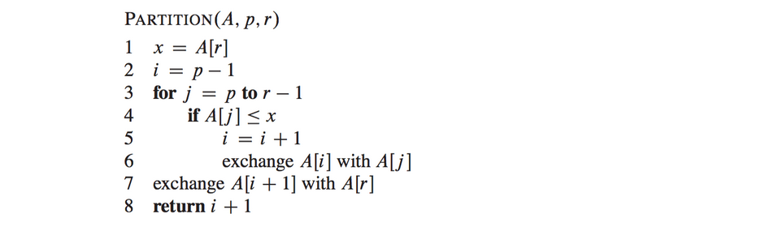

# Big O Notation and Sorting Algorithms Exercises

<quiz-mode></quiz-mode>

## Exercise 1

Solve these logarithmic equations:
1. Solve for $x$: $\log_2(8) = x$
2. Solve for $x$: $\log_{10}(100) = x$
3. Solve for $x$: $\log_3(9) = x$
4. Solve for $x$: $\log_5(125) = x$
5. Solve for $x$: $\log_7(1) = x$

<details>
<summary>Click here to view the answer</summary>

<quiz-answer hint="Type the 5 answers in order, separated by commas.">3, 2, 2, 3, 0</quiz-answer>

1. $x = 3$
2. $x = 2$
3. $x = 2$
4. $x = 3$
5. $x = 0$

</details>


## Exercise 2

To what familiar algorithm does this correspond?

```java
public void someMethod(int[] list){
	for (int outer = 0; outer < list.length - 1; outer++){
        int min = outer;
	    for (int inner = outer + 1; inner < list.length; inner++){
	      if (list[inner] < list[min]){
	        min = inner;
	      }
	    }
	    int temp = list[outer];
	    list[outer] = list[min];
	    list[min] = temp;
	}
}
```

<details>
<summary>Click here to view the answer</summary>

<quiz-answer hint="Type the name of the algorithm.">selection sort</quiz-answer>
<quiz-answer>selection</quiz-answer>

This is an example of selection sort.

</details>

## Exercise 3

Number your lines of code in the algorithm from #2 and fill in the table below, where N is the length of list.  (You may not necessarily use all of them.)

| Line Number | Relative Cost to Execute | Max Times Executed |
| ----------- | --------------- | ----------- |
| 1 | | |
| 2 | | |
| 3 | | |
| 4 | | |
| 5 | | |
| 6 | | |
| 7 | | |
| 8 | | |

Use the results from the table to calculate $T(N)$.


<details>
<summary>Click here to view the answer</summary>

<quiz-answer hint="Type the Big O of T(N), like O(1) or O(2^n). (The table isn't checked: compare it with the answer after.)">n^2</quiz-answer>
<quiz-answer>n*n</quiz-answer>

| Line Number | Relative Cost to Execute | Max Times Executed |
| ----------- | --------------- | ----------- |
| 1 | $C_0$ | n |
| 2 | $C_1$ | n - 1 |
| 3 | $C_2$ | (n - 1)(n - 1) |
| 4 | $C_3$ | (n - 1)(n - 2) |
| 5 | $C_4$ | (n - 1)(n - 2) |
| 6 | $C_5$ | n - 1 |
| 7 | $C_6$ | n - 1 |
| 8 | $C_7$ | n - 1 |

The runtime of this program is $O(n^2)$

</details>


## Exercise 4

Consider the code below. To which familiar algorithm does this correspond? Preconditions:   p <= q <= r; arr from p to q is non-decreasing, arr from q + 1 to r is non-decreasing.

```java
public void something(int[] arr, int p, int q, int r){
  int one = q - p + 1;
  int two = r - q;
  
  int[] arrOne = new int[one + 1];
  int[] arrTwo = new int[two + 1];
  
  for(int i = 0; i < one; i++)
      arrOne[i] = arr[p + i];
      
  for(int j = 0; j < two; j++)
      arrTwo[j] = arr[q + 1 + j];
  
  arrOne[one] = Integer.MAX_VALUE;
  arrTwo[two] = Integer.MAX_VALUE;
  
  int i = 0, j = 0;
  for(int k = p; k <= r; k++){
      if(arrOne[i] <= arrTwo[j]){
        arr[k] = arrOne[i];
        i++;
      }else{
        arr[k] = arrTwo[j];
        j++;
      }
  }
}
```

<details>
<summary>Click here to view the answer</summary>

<quiz-answer hint="Type the name of the algorithm.">merge</quiz-answer>
<quiz-answer>merge sort</quiz-answer>
<quiz-answer>mergesort</quiz-answer>
<quiz-answer>merge function</quiz-answer>
<quiz-answer>the merge function</quiz-answer>
<quiz-answer>merge from merge sort</quiz-answer>

This is the Merge function within a Merge Sort algorithm.

</details>

## Exercise 5

Calculate the runtime of the algorithm from #4. Use a simliar process to #3. 

<details>
<summary>Click here to view the answer</summary>

<quiz-answer hint="Type the Big O, like O(1) or O(2^n).">n</quiz-answer>

$O(n)$

</details>

## Exercise 6
Consider the following partition algorithm:


Suppose the array passed as `A` is `{2, 8, 7, 1, 3, 5, 6, 4}`. Show the final order of the array after completing `partition(A, 0, 7)`.


<details>
<summary>Click here to view the answer</summary>

```
{2, 1, 3, 4, 7, 5, 6, 8}
```

</details>

## Exercise 7

Using the process in #3, derive $T(N)$ for `partition` from the previous problem. 

What does $N$ mean for this algorithm?


<details>
<summary>Click here to view the answer</summary>

<quiz-answer hint="Type the Big O, like O(1) or O(2^n). (Then check what N means in the answer.)">n</quiz-answer>

$O(N)$. $N$ is the number of elements in the array `A`. 

</details>

## Exercise 8

Assuming partition above is coded and works as intended, complete the method below for quicksort (not-randomized)

```java
public static void quicksort(int[] arr, int left, int right){ 
}
```

<details>
<summary>Click here to view the answer</summary>

```java
public static void quicksort(int[] arr, int left, int right) {
    // Base case: If the range has 1 or 0 elements, it is already sorted
    if (left < right) {
        // 1. Partition the array and get the pivot's final index
        // Your partition logic uses the element at 'right' as the pivot
        int pivotIndex = partition(arr, left, right);

        // 2. Recursively sort the elements to the left of the pivot
        quicksort(arr, left, pivotIndex - 1);

        // 3. Recursively sort the elements to the right of the pivot
        quicksort(arr, pivotIndex + 1, right);
    }
}
```


</details>

## Exercise 9

Using a recursion tree, derive the best case running time for quicksort. When does this case happen?

<details>
<summary>Click here to view the answer</summary>

<quiz-answer hint="Type the Big O, like O(1) or O(2^n). (Then check when it happens in the answer.)">n log n</quiz-answer>
<quiz-answer>nlog2n</quiz-answer>
<quiz-answer>n log_2 n</quiz-answer>

The best case for quicksort occurs when the pivot selected always divides the array in equal halves. This limits the possible recursion depth to `log(n)` leaving the runtime to be `O(n log n)`
</details>

## Exercise 10

Derive the worst-case running time for quicksort. Under what conditions does this happen?


<details>
<summary>Click here to view the answer</summary>

<quiz-answer hint="Type the Big O, like O(1) or O(2^n). (Then check when it happens in the answer.)">n^2</quiz-answer>

The worst case for quicksort is when your pivot does not divide the array at all(it is larger than all elements or smaller than all elements). This results in a recursion tree of height $n$. Therefore the runtime is  $O(n^2)$

</details>

## Exercise 11

Determine the order of the following algorithm.

```java
public void reverse(ArrayList <Integer> numbers){

    int temp;

    for (int loop = 0; loop <= (numbers.size()-1)/2; loop++){
        temp = numbers.get(loop);
        numbers.set(loop, numbers.get(numbers.size()-loop-1));
        numbers.set(numbers.size()-loop-1, temp);
    }
}

```

- A. $O(1)$
- B. $O(\log n)$
- C. $O(n)$
- D. $O(n^2)$
- E. $O(2^n)$


<details>
<summary>Click here to view the answer</summary>

C. $O(n)$

</details>

## Exercise 12

Select the larger function as $n \to \infty $

- $(3/2)^n$	or $n^\frac{3}{2}$
- $n \log(n)$ or $\log(n^2)$
- $(n+1)!$ or $n^n$
- $n^3$ or $\sqrt{n^5}$
- $n$ or $e^n$


<details>
<summary>Click here to view the answer</summary>

<quiz-answer hint="For each pair, type 1 if the first function is larger or 2 if the second is, separated by commas.">1, 1, 2, 1, 2</quiz-answer>

- $(3/2)^n$
- $n \log(n)$
- $n^n$
- $n^3$ (because $\sqrt{n^5} = n^{2.5}$)
- $e^n$

</details>

## Exercise 13

Order the following functions from largest to smallest.
- A: $n$
- B: $n \log (n)$
- C: $n^\frac{1}{x}$ when $x > 1$
- D: $1$
- E: $\log{n}$
- F: $n!$
- G: $x^n$ when $x > 1$
- H: $n^2$
- I: $n^x$ when $x > 2$

<details>
<summary>Click here to view the answer</summary>

<quiz-answer hint="Type the letters from largest to smallest, separated by commas.">F, G, I, H, B, A, C, E, D</quiz-answer>

**F, G, I, H, B, A, C, E, D**

1. F: $n!$ (Factorial)
2. G: $x^n$ when $x > 1$ (Exponential - e.g., $2^n, 3^n$)
3. I: $n^x$ when $x > 2$ (Polynomial degree > 2 - e.g., $n^3, n^4$)
4. H: $n^2$ (Quadratic)
5. B: $n \log n$ (Linearithmic)
6. A: $n$ (Linear)
7. C: $n^{1/x}$ when $x > 1$ (Fractional power/Root - e.g., $\sqrt{n}$ or $n^{0.5}$)
8. E: $\log n$ (Logarithmic)
9. D: $1$ (Constant)

</details>

## Exercise 14

After ONE full pass of bubble sort, sorting smallest to largest, what does the array look like?  Array: [7, 2, 5, 3, 9, 1, 15, 14]

<details>
<summary>Click here to view the answer</summary>

```
[2, 5, 3, 7, 1, 9, 14, 15]
```

</details>

## Exercise 15

How many calls are made to line 4 in the worst case of this sort? Leave your answer in terms of $n$.

```java
public static void mysterySort(int[] arr) {
        for (int i = 0; i < arr.length - 1; i++) {
            int minIndex = i;
            for (int j = i + 1; j < arr.length; j++) {
                if (arr[j] < arr[minIndex]) { //line 4
                    minIndex = j;
                }
            }
            if (minIndex != i) {
                int temp = arr[minIndex];
                arr[minIndex] = arr[i];
                arr[i] = temp;
            }
        }
}
```

<details>
<summary>Click here to view the answer</summary>

<quiz-answer hint="Type a formula in terms of n, like 3n^2 + 1.">n(n-1)/2</quiz-answer>
<quiz-answer>(n^2-n)/2</quiz-answer>
<quiz-answer>n^2/2-n/2</quiz-answer>
<quiz-answer>(n-1)n/2</quiz-answer>
<quiz-answer>(n(n-1))/2</quiz-answer>
<quiz-answer>0.5n^2-0.5n</quiz-answer>
<quiz-answer>1/2n^2-1/2n</quiz-answer>
<quiz-answer>.5n^2-.5n</quiz-answer>

$\frac{n(n-1)}{2}$ times, which is $O(n^2)$.

The inner loop runs $n - 1$ times the first pass, then $n - 2$, and so on down to $1$:

$$(n-1) + (n-2) + \cdots + 1 = \frac{n(n-1)}{2}$$

</details>

