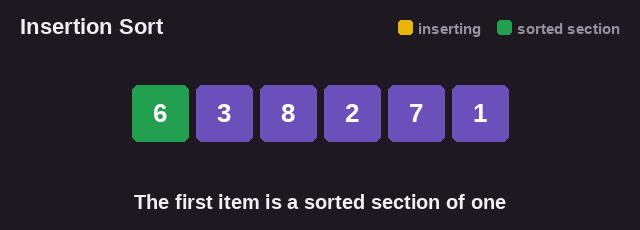
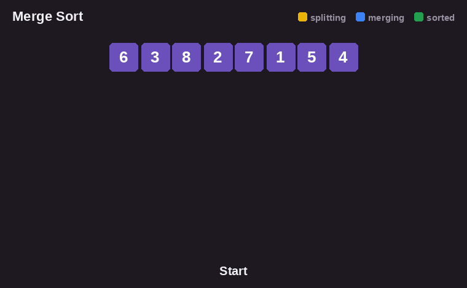
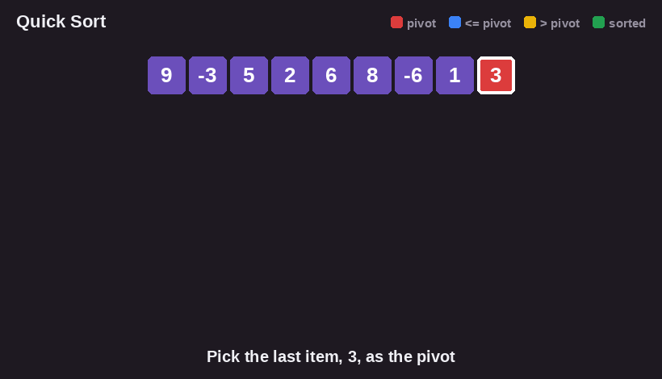

# Big O Notation and Sorting Algorithms Notes

## Vocabulary

| Vocabulary | Description |
| ----------- | ----------- |
| run-time | the time it takes for an algorithm to complete a task |
| function | a relation between a set of inputs and a set of outputs |
| limit | what a function's output gets close to as its input approaches a value |
| Big O notation | a way to describe how an algorithm's run-time or memory grows as the input size grows |
| time complexity | how the number of steps an algorithm takes grows with the input size |
| memory complexity | how the amount of memory an algorithm uses grows with the input size |
| logarithm | the inverse of an exponent: $\log_b x$ asks "what power of $b$ gives $x$?" |
| pivot | in quick sort, the item that the array is split around |

## What is Run-Time?

The **run-time** (or running time) is how long an algorithm takes to finish. It depends on things like the computer's speed, the programming language, and most of all, **how much data** it has to work with.

We can think of an algorithm's run-time as a **function**: the input $n$ is the number of items, and the output is the number of steps the computer takes.

## Limits

A **limit** describes what a function gets close to as its input approaches a value. For example, as $x$ gets bigger and bigger, $\frac{1}{x}$ gets closer and closer to 0:

$$\lim_{x \to \infty} \frac{1}{x} = 0$$

Functions can also approach *other functions*. That's the idea behind Big O.

## What is Big O Notation?

**Big O notation** (or asymptotic notation) describes how an algorithm's run-time or memory grows as the input gets very large. We care about the **shape** of the growth, not the exact number of steps.

If $f(n)$ is the run-time for $n$ inputs, Big O keeps only the **largest term** and drops the constants:

$$f(n) = n^2 + 2n + 3 \quad\Rightarrow\quad O(n^2)$$

This works because as $n \to \infty$, the smaller terms stop mattering compared to $n^2$:

$$\lim_{n \to \infty} \frac{2n + 3}{n^2} = 0$$

### Common Functions

| Big O | Name | Example | Rating |
| --- | --- | --- | --- |
| $O(1)$ | constant | getting `arr[5]` | Excellent |
| $O(\log n)$ | logarithmic | binary search | Excellent |
| $O(n)$ | linear | one loop through an array | Fair |
| $O(n \log n)$ | linearithmic | merge sort | Bad |
| $O(n^2)$ | quadratic | a loop inside a loop | Horrible |
| $O(n^3)$ | cubic | three nested loops | Horrible |
| $O(2^n)$ | exponential | trying every subset | Horrible |

<div style="text-align: center; margin: 1rem 0;">
<svg viewBox="0 0 560 320" width="560" style="max-width: 100%; height: auto;" role="img" aria-label="Graph of common Big O functions. From slowest growing to fastest: O(1), O(log n), O(n), O(n log n), O(n squared), and O(2 to the n)." font-family="inherit" fill="currentColor"><defs><clipPath id="bigo-clip"><rect x="50" y="20" width="360" height="240"/></clipPath></defs><line x1="50" y1="260" x2="410" y2="260" stroke="currentColor"/><line x1="50" y1="20" x2="50" y2="260" stroke="currentColor"/><text x="230.0" y="294" font-size="14" text-anchor="middle">Number of elements (n)</text><text x="16" y="140.0" font-size="14" text-anchor="middle" transform="rotate(-90 16 140.0)">Operations</text><polyline clip-path="url(#bigo-clip)" fill="none" stroke="#22c55e" stroke-width="3" points="50.0,255.2 51.8,255.2 53.6,255.2 55.4,255.2 57.2,255.2 59.0,255.2 60.8,255.2 62.6,255.2 64.4,255.2 66.2,255.2 68.0,255.2 69.8,255.2 71.6,255.2 73.4,255.2 75.2,255.2 77.0,255.2 78.8,255.2 80.6,255.2 82.4,255.2 84.2,255.2 86.0,255.2 87.8,255.2 89.6,255.2 91.4,255.2 93.2,255.2 95.0,255.2 96.8,255.2 98.6,255.2 100.4,255.2 102.2,255.2 104.0,255.2 105.8,255.2 107.6,255.2 109.4,255.2 111.2,255.2 113.0,255.2 114.8,255.2 116.6,255.2 118.4,255.2 120.2,255.2 122.0,255.2 123.8,255.2 125.6,255.2 127.4,255.2 129.2,255.2 131.0,255.2 132.8,255.2 134.6,255.2 136.4,255.2 138.2,255.2 140.0,255.2 141.8,255.2 143.6,255.2 145.4,255.2 147.2,255.2 149.0,255.2 150.8,255.2 152.6,255.2 154.4,255.2 156.2,255.2 158.0,255.2 159.8,255.2 161.6,255.2 163.4,255.2 165.2,255.2 167.0,255.2 168.8,255.2 170.6,255.2 172.4,255.2 174.2,255.2 176.0,255.2 177.8,255.2 179.6,255.2 181.4,255.2 183.2,255.2 185.0,255.2 186.8,255.2 188.6,255.2 190.4,255.2 192.2,255.2 194.0,255.2 195.8,255.2 197.6,255.2 199.4,255.2 201.2,255.2 203.0,255.2 204.8,255.2 206.6,255.2 208.4,255.2 210.2,255.2 212.0,255.2 213.8,255.2 215.6,255.2 217.4,255.2 219.2,255.2 221.0,255.2 222.8,255.2 224.6,255.2 226.4,255.2 228.2,255.2 230.0,255.2 231.8,255.2 233.6,255.2 235.4,255.2 237.2,255.2 239.0,255.2 240.8,255.2 242.6,255.2 244.4,255.2 246.2,255.2 248.0,255.2 249.8,255.2 251.6,255.2 253.4,255.2 255.2,255.2 257.0,255.2 258.8,255.2 260.6,255.2 262.4,255.2 264.2,255.2 266.0,255.2 267.8,255.2 269.6,255.2 271.4,255.2 273.2,255.2 275.0,255.2 276.8,255.2 278.6,255.2 280.4,255.2 282.2,255.2 284.0,255.2 285.8,255.2 287.6,255.2 289.4,255.2 291.2,255.2 293.0,255.2 294.8,255.2 296.6,255.2 298.4,255.2 300.2,255.2 302.0,255.2 303.8,255.2 305.6,255.2 307.4,255.2 309.2,255.2 311.0,255.2 312.8,255.2 314.6,255.2 316.4,255.2 318.2,255.2 320.0,255.2 321.8,255.2 323.6,255.2 325.4,255.2 327.2,255.2 329.0,255.2 330.8,255.2 332.6,255.2 334.4,255.2 336.2,255.2 338.0,255.2 339.8,255.2 341.6,255.2 343.4,255.2 345.2,255.2 347.0,255.2 348.8,255.2 350.6,255.2 352.4,255.2 354.2,255.2 356.0,255.2 357.8,255.2 359.6,255.2 361.4,255.2 363.2,255.2 365.0,255.2 366.8,255.2 368.6,255.2 370.4,255.2 372.2,255.2 374.0,255.2 375.8,255.2 377.6,255.2 379.4,255.2 381.2,255.2 383.0,255.2 384.8,255.2 386.6,255.2 388.4,255.2 390.2,255.2 392.0,255.2 393.8,255.2 395.6,255.2 397.4,255.2 399.2,255.2 401.0,255.2 402.8,255.2 404.6,255.2 406.4,255.2 408.2,255.2 410.0,255.2"/><polyline clip-path="url(#bigo-clip)" fill="none" stroke="#84cc16" stroke-width="3" points="86.0,260.0 87.8,259.7 89.6,259.3 91.4,259.0 93.2,258.7 95.0,258.5 96.8,258.2 98.6,257.9 100.4,257.7 102.2,257.4 104.0,257.2 105.8,257.0 107.6,256.7 109.4,256.5 111.2,256.3 113.0,256.1 114.8,255.9 116.6,255.7 118.4,255.6 120.2,255.4 122.0,255.2 123.8,255.0 125.6,254.9 127.4,254.7 129.2,254.5 131.0,254.4 132.8,254.2 134.6,254.1 136.4,253.9 138.2,253.8 140.0,253.7 141.8,253.5 143.6,253.4 145.4,253.3 147.2,253.1 149.0,253.0 150.8,252.9 152.6,252.7 154.4,252.6 156.2,252.5 158.0,252.4 159.8,252.3 161.6,252.2 163.4,252.1 165.2,251.9 167.0,251.8 168.8,251.7 170.6,251.6 172.4,251.5 174.2,251.4 176.0,251.3 177.8,251.2 179.6,251.1 181.4,251.0 183.2,250.9 185.0,250.8 186.8,250.8 188.6,250.7 190.4,250.6 192.2,250.5 194.0,250.4 195.8,250.3 197.6,250.2 199.4,250.1 201.2,250.1 203.0,250.0 204.8,249.9 206.6,249.8 208.4,249.7 210.2,249.7 212.0,249.6 213.8,249.5 215.6,249.4 217.4,249.4 219.2,249.3 221.0,249.2 222.8,249.1 224.6,249.1 226.4,249.0 228.2,248.9 230.0,248.9 231.8,248.8 233.6,248.7 235.4,248.7 237.2,248.6 239.0,248.5 240.8,248.5 242.6,248.4 244.4,248.3 246.2,248.3 248.0,248.2 249.8,248.1 251.6,248.1 253.4,248.0 255.2,247.9 257.0,247.9 258.8,247.8 260.6,247.8 262.4,247.7 264.2,247.7 266.0,247.6 267.8,247.5 269.6,247.5 271.4,247.4 273.2,247.4 275.0,247.3 276.8,247.3 278.6,247.2 280.4,247.1 282.2,247.1 284.0,247.0 285.8,247.0 287.6,246.9 289.4,246.9 291.2,246.8 293.0,246.8 294.8,246.7 296.6,246.7 298.4,246.6 300.2,246.6 302.0,246.5 303.8,246.5 305.6,246.4 307.4,246.4 309.2,246.3 311.0,246.3 312.8,246.2 314.6,246.2 316.4,246.1 318.2,246.1 320.0,246.0 321.8,246.0 323.6,246.0 325.4,245.9 327.2,245.9 329.0,245.8 330.8,245.8 332.6,245.7 334.4,245.7 336.2,245.6 338.0,245.6 339.8,245.6 341.6,245.5 343.4,245.5 345.2,245.4 347.0,245.4 348.8,245.3 350.6,245.3 352.4,245.3 354.2,245.2 356.0,245.2 357.8,245.1 359.6,245.1 361.4,245.1 363.2,245.0 365.0,245.0 366.8,244.9 368.6,244.9 370.4,244.9 372.2,244.8 374.0,244.8 375.8,244.7 377.6,244.7 379.4,244.7 381.2,244.6 383.0,244.6 384.8,244.6 386.6,244.5 388.4,244.5 390.2,244.4 392.0,244.4 393.8,244.4 395.6,244.3 397.4,244.3 399.2,244.3 401.0,244.2 402.8,244.2 404.6,244.2 406.4,244.1 408.2,244.1 410.0,244.1"/><polyline clip-path="url(#bigo-clip)" fill="none" stroke="#eab308" stroke-width="3" points="50.0,260.0 51.8,259.8 53.6,259.5 55.4,259.3 57.2,259.0 59.0,258.8 60.8,258.6 62.6,258.3 64.4,258.1 66.2,257.8 68.0,257.6 69.8,257.4 71.6,257.1 73.4,256.9 75.2,256.6 77.0,256.4 78.8,256.2 80.6,255.9 82.4,255.7 84.2,255.4 86.0,255.2 87.8,255.0 89.6,254.7 91.4,254.5 93.2,254.2 95.0,254.0 96.8,253.8 98.6,253.5 100.4,253.3 102.2,253.0 104.0,252.8 105.8,252.6 107.6,252.3 109.4,252.1 111.2,251.8 113.0,251.6 114.8,251.4 116.6,251.1 118.4,250.9 120.2,250.6 122.0,250.4 123.8,250.2 125.6,249.9 127.4,249.7 129.2,249.4 131.0,249.2 132.8,249.0 134.6,248.7 136.4,248.5 138.2,248.2 140.0,248.0 141.8,247.8 143.6,247.5 145.4,247.3 147.2,247.0 149.0,246.8 150.8,246.6 152.6,246.3 154.4,246.1 156.2,245.8 158.0,245.6 159.8,245.4 161.6,245.1 163.4,244.9 165.2,244.6 167.0,244.4 168.8,244.2 170.6,243.9 172.4,243.7 174.2,243.4 176.0,243.2 177.8,243.0 179.6,242.7 181.4,242.5 183.2,242.2 185.0,242.0 186.8,241.8 188.6,241.5 190.4,241.3 192.2,241.0 194.0,240.8 195.8,240.6 197.6,240.3 199.4,240.1 201.2,239.8 203.0,239.6 204.8,239.4 206.6,239.1 208.4,238.9 210.2,238.6 212.0,238.4 213.8,238.2 215.6,237.9 217.4,237.7 219.2,237.4 221.0,237.2 222.8,237.0 224.6,236.7 226.4,236.5 228.2,236.2 230.0,236.0 231.8,235.8 233.6,235.5 235.4,235.3 237.2,235.0 239.0,234.8 240.8,234.6 242.6,234.3 244.4,234.1 246.2,233.8 248.0,233.6 249.8,233.4 251.6,233.1 253.4,232.9 255.2,232.6 257.0,232.4 258.8,232.2 260.6,231.9 262.4,231.7 264.2,231.4 266.0,231.2 267.8,231.0 269.6,230.7 271.4,230.5 273.2,230.2 275.0,230.0 276.8,229.8 278.6,229.5 280.4,229.3 282.2,229.0 284.0,228.8 285.8,228.6 287.6,228.3 289.4,228.1 291.2,227.8 293.0,227.6 294.8,227.4 296.6,227.1 298.4,226.9 300.2,226.6 302.0,226.4 303.8,226.2 305.6,225.9 307.4,225.7 309.2,225.4 311.0,225.2 312.8,225.0 314.6,224.7 316.4,224.5 318.2,224.2 320.0,224.0 321.8,223.8 323.6,223.5 325.4,223.3 327.2,223.0 329.0,222.8 330.8,222.6 332.6,222.3 334.4,222.1 336.2,221.8 338.0,221.6 339.8,221.4 341.6,221.1 343.4,220.9 345.2,220.6 347.0,220.4 348.8,220.2 350.6,219.9 352.4,219.7 354.2,219.4 356.0,219.2 357.8,219.0 359.6,218.7 361.4,218.5 363.2,218.2 365.0,218.0 366.8,217.8 368.6,217.5 370.4,217.3 372.2,217.0 374.0,216.8 375.8,216.6 377.6,216.3 379.4,216.1 381.2,215.8 383.0,215.6 384.8,215.4 386.6,215.1 388.4,214.9 390.2,214.6 392.0,214.4 393.8,214.2 395.6,213.9 397.4,213.7 399.2,213.4 401.0,213.2 402.8,213.0 404.6,212.7 406.4,212.5 408.2,212.2 410.0,212.0"/><polyline clip-path="url(#bigo-clip)" fill="none" stroke="#f97316" stroke-width="3" points="86.0,260.0 87.8,259.6 89.6,259.3 91.4,258.9 93.2,258.5 95.0,258.1 96.8,257.6 98.6,257.2 100.4,256.7 102.2,256.3 104.0,255.8 105.8,255.3 107.6,254.8 109.4,254.3 111.2,253.8 113.0,253.2 114.8,252.7 116.6,252.1 118.4,251.6 120.2,251.0 122.0,250.4 123.8,249.8 125.6,249.2 127.4,248.6 129.2,248.0 131.0,247.4 132.8,246.7 134.6,246.1 136.4,245.4 138.2,244.8 140.0,244.1 141.8,243.5 143.6,242.8 145.4,242.1 147.2,241.4 149.0,240.7 150.8,240.0 152.6,239.3 154.4,238.6 156.2,237.9 158.0,237.2 159.8,236.4 161.6,235.7 163.4,235.0 165.2,234.2 167.0,233.5 168.8,232.7 170.6,232.0 172.4,231.2 174.2,230.4 176.0,229.6 177.8,228.9 179.6,228.1 181.4,227.3 183.2,226.5 185.0,225.7 186.8,224.9 188.6,224.1 190.4,223.2 192.2,222.4 194.0,221.6 195.8,220.8 197.6,219.9 199.4,219.1 201.2,218.3 203.0,217.4 204.8,216.6 206.6,215.7 208.4,214.9 210.2,214.0 212.0,213.1 213.8,212.3 215.6,211.4 217.4,210.5 219.2,209.6 221.0,208.7 222.8,207.9 224.6,207.0 226.4,206.1 228.2,205.2 230.0,204.3 231.8,203.4 233.6,202.5 235.4,201.5 237.2,200.6 239.0,199.7 240.8,198.8 242.6,197.9 244.4,196.9 246.2,196.0 248.0,195.1 249.8,194.1 251.6,193.2 253.4,192.2 255.2,191.3 257.0,190.3 258.8,189.4 260.6,188.4 262.4,187.5 264.2,186.5 266.0,185.6 267.8,184.6 269.6,183.6 271.4,182.6 273.2,181.7 275.0,180.7 276.8,179.7 278.6,178.7 280.4,177.7 282.2,176.7 284.0,175.7 285.8,174.8 287.6,173.8 289.4,172.8 291.2,171.7 293.0,170.7 294.8,169.7 296.6,168.7 298.4,167.7 300.2,166.7 302.0,165.7 303.8,164.7 305.6,163.6 307.4,162.6 309.2,161.6 311.0,160.5 312.8,159.5 314.6,158.5 316.4,157.4 318.2,156.4 320.0,155.4 321.8,154.3 323.6,153.3 325.4,152.2 327.2,151.2 329.0,150.1 330.8,149.0 332.6,148.0 334.4,146.9 336.2,145.9 338.0,144.8 339.8,143.7 341.6,142.7 343.4,141.6 345.2,140.5 347.0,139.4 348.8,138.4 350.6,137.3 352.4,136.2 354.2,135.1 356.0,134.0 357.8,132.9 359.6,131.9 361.4,130.8 363.2,129.7 365.0,128.6 366.8,127.5 368.6,126.4 370.4,125.3 372.2,124.2 374.0,123.1 375.8,122.0 377.6,120.8 379.4,119.7 381.2,118.6 383.0,117.5 384.8,116.4 386.6,115.3 388.4,114.1 390.2,113.0 392.0,111.9 393.8,110.8 395.6,109.6 397.4,108.5 399.2,107.4 401.0,106.2 402.8,105.1 404.6,104.0 406.4,102.8 408.2,101.7 410.0,100.5"/><polyline clip-path="url(#bigo-clip)" fill="none" stroke="#ef4444" stroke-width="3" points="50.0,260.0 51.8,260.0 53.6,260.0 55.4,259.9 57.2,259.8 59.0,259.7 60.8,259.6 62.6,259.4 64.4,259.2 66.2,259.0 68.0,258.8 69.8,258.5 71.6,258.3 73.4,258.0 75.2,257.6 77.0,257.3 78.8,256.9 80.6,256.5 82.4,256.1 84.2,255.7 86.0,255.2 87.8,254.7 89.6,254.2 91.4,253.7 93.2,253.1 95.0,252.5 96.8,251.9 98.6,251.3 100.4,250.6 102.2,249.9 104.0,249.2 105.8,248.5 107.6,247.7 109.4,246.9 111.2,246.1 113.0,245.3 114.8,244.4 116.6,243.6 118.4,242.7 120.2,241.7 122.0,240.8 123.8,239.8 125.6,238.8 127.4,237.8 129.2,236.8 131.0,235.7 132.8,234.6 134.6,233.5 136.4,232.4 138.2,231.2 140.0,230.0 141.8,228.8 143.6,227.6 145.4,226.3 147.2,225.0 149.0,223.7 150.8,222.4 152.6,221.0 154.4,219.6 156.2,218.2 158.0,216.8 159.8,215.3 161.6,213.9 163.4,212.4 165.2,210.8 167.0,209.3 168.8,207.7 170.6,206.1 172.4,204.5 174.2,202.9 176.0,201.2 177.8,199.5 179.6,197.8 181.4,196.1 183.2,194.3 185.0,192.5 186.8,190.7 188.6,188.9 190.4,187.0 192.2,185.1 194.0,183.2 195.8,181.3 197.6,179.3 199.4,177.3 201.2,175.3 203.0,173.3 204.8,171.2 206.6,169.2 208.4,167.1 210.2,164.9 212.0,162.8 213.8,160.6 215.6,158.4 217.4,156.2 219.2,154.0 221.0,151.7 222.8,149.4 224.6,147.1 226.4,144.8 228.2,142.4 230.0,140.0 231.8,137.6 233.6,135.2 235.4,132.7 237.2,130.2 239.0,127.7 240.8,125.2 242.6,122.6 244.4,120.0 246.2,117.4 248.0,114.8 249.8,112.1 251.6,109.5 253.4,106.8 255.2,104.0 257.0,101.3 258.8,98.5 260.6,95.7 262.4,92.9 264.2,90.1 266.0,87.2 267.8,84.3 269.6,81.4 271.4,78.5 273.2,75.5 275.0,72.5 276.8,69.5 278.6,66.5 280.4,63.4 282.2,60.3 284.0,57.2 285.8,54.1 287.6,50.9 289.4,47.7 291.2,44.5 293.0,41.3 294.8,38.0 296.6,34.8 298.4,31.5 300.2,28.1 302.0,24.8 303.8,21.4 305.6,18.0 307.4,14.6 309.2,11.2 311.0,8.0 312.8,8.0 314.6,8.0 316.4,8.0 318.2,8.0 320.0,8.0 321.8,8.0 323.6,8.0 325.4,8.0 327.2,8.0 329.0,8.0 330.8,8.0 332.6,8.0 334.4,8.0 336.2,8.0 338.0,8.0 339.8,8.0 341.6,8.0 343.4,8.0 345.2,8.0 347.0,8.0 348.8,8.0 350.6,8.0 352.4,8.0 354.2,8.0 356.0,8.0 357.8,8.0 359.6,8.0 361.4,8.0 363.2,8.0 365.0,8.0 366.8,8.0 368.6,8.0 370.4,8.0 372.2,8.0 374.0,8.0 375.8,8.0 377.6,8.0 379.4,8.0 381.2,8.0 383.0,8.0 384.8,8.0 386.6,8.0 388.4,8.0 390.2,8.0 392.0,8.0 393.8,8.0 395.6,8.0 397.4,8.0 399.2,8.0 401.0,8.0 402.8,8.0 404.6,8.0 406.4,8.0 408.2,8.0 410.0,8.0"/><polyline clip-path="url(#bigo-clip)" fill="none" stroke="#b91c1c" stroke-width="3" points="50.0,255.2 51.8,255.0 53.6,254.9 55.4,254.7 57.2,254.5 59.0,254.3 60.8,254.1 62.6,253.9 64.4,253.7 66.2,253.4 68.0,253.2 69.8,253.0 71.6,252.7 73.4,252.5 75.2,252.2 77.0,251.9 78.8,251.6 80.6,251.3 82.4,251.0 84.2,250.7 86.0,250.4 87.8,250.1 89.6,249.7 91.4,249.3 93.2,249.0 95.0,248.6 96.8,248.2 98.6,247.8 100.4,247.3 102.2,246.9 104.0,246.4 105.8,245.9 107.6,245.4 109.4,244.9 111.2,244.4 113.0,243.9 114.8,243.3 116.6,242.7 118.4,242.1 120.2,241.5 122.0,240.8 123.8,240.1 125.6,239.4 127.4,238.7 129.2,237.9 131.0,237.2 132.8,236.4 134.6,235.5 136.4,234.7 138.2,233.8 140.0,232.8 141.8,231.9 143.6,230.9 145.4,229.9 147.2,228.8 149.0,227.7 150.8,226.6 152.6,225.4 154.4,224.2 156.2,222.9 158.0,221.6 159.8,220.2 161.6,218.8 163.4,217.4 165.2,215.9 167.0,214.3 168.8,212.7 170.6,211.1 172.4,209.3 174.2,207.5 176.0,205.7 177.8,203.8 179.6,201.8 181.4,199.7 183.2,197.6 185.0,195.4 186.8,193.1 188.6,190.8 190.4,188.3 192.2,185.8 194.0,183.2 195.8,180.5 197.6,177.7 199.4,174.8 201.2,171.8 203.0,168.7 204.8,165.4 206.6,162.1 208.4,158.7 210.2,155.1 212.0,151.4 213.8,147.6 215.6,143.6 217.4,139.5 219.2,135.2 221.0,130.8 222.8,126.3 224.6,121.6 226.4,116.7 228.2,111.6 230.0,106.4 231.8,101.0 233.6,95.4 235.4,89.6 237.2,83.6 239.0,77.3 240.8,70.9 242.6,64.2 244.4,57.3 246.2,50.2 248.0,42.8 249.8,35.1 251.6,27.2 253.4,19.0 255.2,10.5 257.0,8.0 258.8,8.0 260.6,8.0 262.4,8.0 264.2,8.0 266.0,8.0 267.8,8.0 269.6,8.0 271.4,8.0 273.2,8.0 275.0,8.0 276.8,8.0 278.6,8.0 280.4,8.0 282.2,8.0 284.0,8.0 285.8,8.0 287.6,8.0 289.4,8.0 291.2,8.0 293.0,8.0 294.8,8.0 296.6,8.0 298.4,8.0 300.2,8.0 302.0,8.0 303.8,8.0 305.6,8.0 307.4,8.0 309.2,8.0 311.0,8.0 312.8,8.0 314.6,8.0 316.4,8.0 318.2,8.0 320.0,8.0 321.8,8.0 323.6,8.0 325.4,8.0 327.2,8.0 329.0,8.0 330.8,8.0 332.6,8.0 334.4,8.0 336.2,8.0 338.0,8.0 339.8,8.0 341.6,8.0 343.4,8.0 345.2,8.0 347.0,8.0 348.8,8.0 350.6,8.0 352.4,8.0 354.2,8.0 356.0,8.0 357.8,8.0 359.6,8.0 361.4,8.0 363.2,8.0 365.0,8.0 366.8,8.0 368.6,8.0 370.4,8.0 372.2,8.0 374.0,8.0 375.8,8.0 377.6,8.0 379.4,8.0 381.2,8.0 383.0,8.0 384.8,8.0 386.6,8.0 388.4,8.0 390.2,8.0 392.0,8.0 393.8,8.0 395.6,8.0 397.4,8.0 399.2,8.0 401.0,8.0 402.8,8.0 404.6,8.0 406.4,8.0 408.2,8.0 410.0,8.0"/><rect x="432" y="27" width="14" height="14" rx="3" fill="#b91c1c"/><text x="454" y="39" font-size="14" font-weight="bold">O(2ⁿ)</text><rect x="432" y="53" width="14" height="14" rx="3" fill="#ef4444"/><text x="454" y="65" font-size="14" font-weight="bold">O(n²)</text><rect x="432" y="79" width="14" height="14" rx="3" fill="#f97316"/><text x="454" y="91" font-size="14" font-weight="bold">O(n log n)</text><rect x="432" y="105" width="14" height="14" rx="3" fill="#eab308"/><text x="454" y="117" font-size="14" font-weight="bold">O(n)</text><rect x="432" y="131" width="14" height="14" rx="3" fill="#84cc16"/><text x="454" y="143" font-size="14" font-weight="bold">O(log n)</text><rect x="432" y="157" width="14" height="14" rx="3" fill="#22c55e"/><text x="454" y="169" font-size="14" font-weight="bold">O(1)</text></svg>
</div>

### Logarithms

A **logarithm** is the inverse of an exponent.

$$b^y = x \quad\Longleftrightarrow\quad y = \log_b x$$

For example, $2^3 = 8$, so $\log_2 8 = 3$.

In computer science, $\log n$ usually means $\log_2 n$: **how many times you can cut $n$ in half** before you reach 1. Algorithms that cut the problem in half each step, like binary search, are $O(\log n)$.

### Big O, Big Ω, and Big Θ

| Notation | Meaning | Think of it as |
| --- | --- | --- |
| Big $O$ | upper bound | the **worst case**: it can't get slower than this |
| Big $\Omega$ | lower bound | the **best case**: it can't get faster than this |
| Big $\Theta$ | tight bound | the upper and lower bounds are the same |

<div style="text-align: center; margin: 1rem 0;">
<svg viewBox="0 0 440 270" width="440" style="max-width: 100%; height: auto;" role="img" aria-label="An algorithm's run-time wiggles between an upper bound curve labeled Big O and a lower bound curve labeled Big Omega." font-family="inherit" fill="currentColor"><line x1="40" y1="210" x2="420" y2="210" stroke="currentColor"/><line x1="40" y1="20" x2="40" y2="210" stroke="currentColor"/><text x="230.0" y="242" font-size="14" text-anchor="middle">Number of elements (n)</text><text x="14" y="115.0" font-size="14" text-anchor="middle" transform="rotate(-90 14 115.0)">Operations</text><polyline fill="none" stroke="#ef4444" stroke-width="3"  points="40.0,130.2 41.9,130.2 43.8,130.2 45.7,130.2 47.6,130.2 49.5,130.1 51.4,130.1 53.3,130.1 55.2,130.0 57.1,130.0 59.0,130.0 60.9,129.9 62.8,129.9 64.7,129.8 66.6,129.7 68.5,129.7 70.4,129.6 72.3,129.5 74.2,129.4 76.1,129.3 78.0,129.2 79.9,129.2 81.8,129.1 83.7,128.9 85.6,128.8 87.5,128.7 89.4,128.6 91.3,128.5 93.2,128.3 95.1,128.2 97.0,128.1 98.9,127.9 100.8,127.8 102.7,127.6 104.6,127.5 106.5,127.3 108.4,127.1 110.3,126.9 112.2,126.8 114.1,126.6 116.0,126.4 117.9,126.2 119.8,126.0 121.7,125.8 123.6,125.6 125.5,125.4 127.4,125.2 129.3,125.0 131.2,124.7 133.1,124.5 135.0,124.3 136.9,124.0 138.8,123.8 140.7,123.5 142.6,123.3 144.5,123.0 146.4,122.8 148.3,122.5 150.2,122.2 152.1,121.9 154.0,121.7 155.9,121.4 157.8,121.1 159.7,120.8 161.6,120.5 163.5,120.2 165.4,119.9 167.3,119.5 169.2,119.2 171.1,118.9 173.0,118.6 174.9,118.2 176.8,117.9 178.7,117.5 180.6,117.2 182.5,116.8 184.4,116.5 186.3,116.1 188.2,115.8 190.1,115.4 192.0,115.0 193.9,114.6 195.8,114.2 197.7,113.8 199.6,113.4 201.5,113.0 203.4,112.6 205.3,112.2 207.2,111.8 209.1,111.4 211.0,111.0 212.9,110.5 214.8,110.1 216.7,109.7 218.6,109.2 220.5,108.8 222.4,108.3 224.3,107.9 226.2,107.4 228.1,106.9 230.0,106.5 231.9,106.0 233.8,105.5 235.7,105.0 237.6,104.5 239.5,104.0 241.4,103.5 243.3,103.0 245.2,102.5 247.1,102.0 249.0,101.5 250.9,100.9 252.8,100.4 254.7,99.9 256.6,99.3 258.5,98.8 260.4,98.2 262.3,97.7 264.2,97.1 266.1,96.6 268.0,96.0 269.9,95.4 271.8,94.9 273.7,94.3 275.6,93.7 277.5,93.1 279.4,92.5 281.3,91.9 283.2,91.3 285.1,90.7 287.0,90.1 288.9,89.4 290.8,88.8 292.7,88.2 294.6,87.6 296.5,86.9 298.4,86.3 300.3,85.6 302.2,85.0 304.1,84.3 306.0,83.7 307.9,83.0 309.8,82.3 311.7,81.6 313.6,81.0 315.5,80.3 317.4,79.6 319.3,78.9 321.2,78.2 323.1,77.5 325.0,76.8 326.9,76.0 328.8,75.3 330.7,74.6 332.6,73.9 334.5,73.1 336.4,72.4 338.3,71.7 340.2,70.9 342.1,70.2 344.0,69.4 345.9,68.6 347.8,67.9 349.7,67.1 351.6,66.3 353.5,65.5 355.4,64.8 357.3,64.0 359.2,63.2 361.1,62.4 363.0,61.6 364.9,60.8 366.8,59.9 368.7,59.1 370.6,58.3 372.5,57.5 374.4,56.6 376.3,55.8 378.2,55.0 380.1,54.1 382.0,53.2 383.9,52.4 385.8,51.5 387.7,50.7 389.6,49.8 391.5,48.9 393.4,48.0 395.3,47.1 397.2,46.3 399.1,45.4 401.0,44.5 402.9,43.6 404.8,42.6 406.7,41.7 408.6,40.8 410.5,39.9 412.4,39.0 414.3,38.0 416.2,37.1 418.1,36.1 420.0,35.2"/><polyline fill="none" stroke="#3b82f6" stroke-width="3"  points="40.0,191.0 41.9,190.7 43.8,190.4 45.7,190.1 47.6,189.9 49.5,189.6 51.4,189.3 53.3,189.0 55.2,188.7 57.1,188.4 59.0,188.2 60.9,187.9 62.8,187.6 64.7,187.3 66.6,187.0 68.5,186.7 70.4,186.4 72.3,186.2 74.2,185.9 76.1,185.6 78.0,185.3 79.9,185.0 81.8,184.7 83.7,184.4 85.6,184.2 87.5,183.9 89.4,183.6 91.3,183.3 93.2,183.0 95.1,182.7 97.0,182.4 98.9,182.2 100.8,181.9 102.7,181.6 104.6,181.3 106.5,181.0 108.4,180.7 110.3,180.5 112.2,180.2 114.1,179.9 116.0,179.6 117.9,179.3 119.8,179.0 121.7,178.7 123.6,178.5 125.5,178.2 127.4,177.9 129.3,177.6 131.2,177.3 133.1,177.0 135.0,176.8 136.9,176.5 138.8,176.2 140.7,175.9 142.6,175.6 144.5,175.3 146.4,175.0 148.3,174.8 150.2,174.5 152.1,174.2 154.0,173.9 155.9,173.6 157.8,173.3 159.7,173.0 161.6,172.8 163.5,172.5 165.4,172.2 167.3,171.9 169.2,171.6 171.1,171.3 173.0,171.1 174.9,170.8 176.8,170.5 178.7,170.2 180.6,169.9 182.5,169.6 184.4,169.3 186.3,169.1 188.2,168.8 190.1,168.5 192.0,168.2 193.9,167.9 195.8,167.6 197.7,167.3 199.6,167.1 201.5,166.8 203.4,166.5 205.3,166.2 207.2,165.9 209.1,165.6 211.0,165.3 212.9,165.1 214.8,164.8 216.7,164.5 218.6,164.2 220.5,163.9 222.4,163.6 224.3,163.4 226.2,163.1 228.1,162.8 230.0,162.5 231.9,162.2 233.8,161.9 235.7,161.6 237.6,161.4 239.5,161.1 241.4,160.8 243.3,160.5 245.2,160.2 247.1,159.9 249.0,159.7 250.9,159.4 252.8,159.1 254.7,158.8 256.6,158.5 258.5,158.2 260.4,157.9 262.3,157.7 264.2,157.4 266.1,157.1 268.0,156.8 269.9,156.5 271.8,156.2 273.7,155.9 275.6,155.7 277.5,155.4 279.4,155.1 281.3,154.8 283.2,154.5 285.1,154.2 287.0,153.9 288.9,153.7 290.8,153.4 292.7,153.1 294.6,152.8 296.5,152.5 298.4,152.2 300.3,152.0 302.2,151.7 304.1,151.4 306.0,151.1 307.9,150.8 309.8,150.5 311.7,150.2 313.6,150.0 315.5,149.7 317.4,149.4 319.3,149.1 321.2,148.8 323.1,148.5 325.0,148.2 326.9,148.0 328.8,147.7 330.7,147.4 332.6,147.1 334.5,146.8 336.4,146.5 338.3,146.3 340.2,146.0 342.1,145.7 344.0,145.4 345.9,145.1 347.8,144.8 349.7,144.5 351.6,144.3 353.5,144.0 355.4,143.7 357.3,143.4 359.2,143.1 361.1,142.8 363.0,142.6 364.9,142.3 366.8,142.0 368.7,141.7 370.6,141.4 372.5,141.1 374.4,140.8 376.3,140.6 378.2,140.3 380.1,140.0 382.0,139.7 383.9,139.4 385.8,139.1 387.7,138.8 389.6,138.6 391.5,138.3 393.4,138.0 395.3,137.7 397.2,137.4 399.1,137.1 401.0,136.8 402.9,136.6 404.8,136.3 406.7,136.0 408.6,135.7 410.5,135.4 412.4,135.1 414.3,134.9 416.2,134.6 418.1,134.3 420.0,134.0"/><polyline fill="none" stroke="#a78bfa" stroke-width="3"  points="40.0,160.6 41.9,159.7 43.8,158.8 45.7,157.9 47.6,157.0 49.5,156.1 51.4,155.1 53.3,154.2 55.2,153.3 57.1,152.4 59.0,151.5 60.9,150.6 62.8,149.7 64.7,148.9 66.6,148.0 68.5,147.2 70.4,146.4 72.3,145.6 74.2,144.9 76.1,144.2 78.0,143.5 79.9,142.9 81.8,142.2 83.7,141.6 85.6,141.1 87.5,140.6 89.4,140.1 91.3,139.6 93.2,139.2 95.1,138.8 97.0,138.4 98.9,138.1 100.8,137.8 102.7,137.5 104.6,137.2 106.5,136.9 108.4,136.7 110.3,136.5 112.2,136.2 114.1,136.0 116.0,135.8 117.9,135.6 119.8,135.4 121.7,135.2 123.6,135.0 125.5,134.8 127.4,134.6 129.3,134.4 131.2,134.1 133.1,133.9 135.0,133.7 136.9,133.5 138.8,133.2 140.7,133.0 142.6,132.8 144.5,132.6 146.4,132.3 148.3,132.1 150.2,131.9 152.1,131.8 154.0,131.6 155.9,131.5 157.8,131.3 159.7,131.3 161.6,131.2 163.5,131.2 165.4,131.2 167.3,131.2 169.2,131.2 171.1,131.3 173.0,131.5 174.9,131.7 176.8,131.9 178.7,132.1 180.6,132.4 182.5,132.7 184.4,133.0 186.3,133.4 188.2,133.8 190.1,134.2 192.0,134.6 193.9,135.0 195.8,135.4 197.7,135.8 199.6,136.2 201.5,136.6 203.4,137.0 205.3,137.3 207.2,137.6 209.1,137.9 211.0,138.1 212.9,138.3 214.8,138.4 216.7,138.5 218.6,138.5 220.5,138.4 222.4,138.3 224.3,138.1 226.2,137.8 228.1,137.5 230.0,137.1 231.9,136.6 233.8,136.0 235.7,135.4 237.6,134.7 239.5,134.0 241.4,133.2 243.3,132.3 245.2,131.4 247.1,130.5 249.0,129.5 250.9,128.5 252.8,127.5 254.7,126.5 256.6,125.5 258.5,124.4 260.4,123.4 262.3,122.4 264.2,121.4 266.1,120.4 268.0,119.5 269.9,118.6 271.8,117.8 273.7,116.9 275.6,116.2 277.5,115.5 279.4,114.8 281.3,114.2 283.2,113.6 285.1,113.1 287.0,112.6 288.9,112.2 290.8,111.7 292.7,111.4 294.6,111.0 296.5,110.7 298.4,110.4 300.3,110.1 302.2,109.8 304.1,109.5 306.0,109.2 307.9,108.9 309.8,108.6 311.7,108.2 313.6,107.8 315.5,107.3 317.4,106.8 319.3,106.2 321.2,105.6 323.1,104.9 325.0,104.2 326.9,103.4 328.8,102.5 330.7,101.5 332.6,100.5 334.5,99.5 336.4,98.3 338.3,97.2 340.2,95.9 342.1,94.7 344.0,93.4 345.9,92.1 347.8,90.7 349.7,89.4 351.6,88.1 353.5,86.7 355.4,85.4 357.3,84.2 359.2,83.0 361.1,81.8 363.0,80.7 364.9,79.6 366.8,78.7 368.7,77.8 370.6,77.0 372.5,76.3 374.4,75.8 376.3,75.3 378.2,74.9 380.1,74.7 382.0,74.6 383.9,74.6 385.8,74.6 387.7,74.8 389.6,75.1 391.5,75.5 393.4,76.0 395.3,76.6 397.2,77.2 399.1,77.9 401.0,78.6 402.9,79.4 404.8,80.2 406.7,81.1 408.6,81.9 410.5,82.7 412.4,83.5 414.3,84.3 416.2,85.0 418.1,85.7 420.0,86.3"/><text x="51" y="114" font-size="14" font-weight="bold" fill="#ef4444">Big O (upper bound)</text><text x="249" y="184" font-size="14" font-weight="bold" fill="#3b82f6">Big Ω (lower bound)</text><text x="276" y="134" font-size="14" font-weight="bold" fill="#a78bfa">your algorithm</text></svg>
</div>

There's also the **average case**: how the algorithm does on typical input. Most of the time, when people say "Big O," they mean the worst case.

## Finding the Complexity of Code

To find an algorithm's complexity, give each line a **cost** ($C_0$, $C_1$, …) and count **how many times** it runs. Add it all up, then keep the biggest term.

### Example 1: One Loop

```java
int[] arr = {…};

for (int i = 0; i < arr.length; i++) {
    System.out.print("hello");
}
```

**Time:**

| Line | Cost | # times |
| --- | --- | --- |
| `int[] arr = {…};` | $C_0$ | $1$ |
| `for (int i = 0; …)` | $C_1$ | $n$ |
| `System.out.print("hello");` | $C_2$ | $n$ |

$$T(n) = C_0 + C_1 n + C_2 n = C_0 + (C_1 + C_2)n \quad\Rightarrow\quad O(n)$$

**Memory:**

| Variable | Cost | # spaces |
| --- | --- | --- |
| `arr` | $C_0$ | $n$ |
| `i` | $C_1$ | $1$ |

$$M(n) = C_0 n + C_1 \quad\Rightarrow\quad O(n)$$

**Time complexity:** $O(n)$. **Memory complexity:** $O(n)$.

### Example 2: A Loop Inside a Loop

```java
int[][] arr = new int[n][n];
int count = 0;

for (int i = 0; i < arr.length; i++) {
    for (int j = 0; j < arr[0].length; j++) {
        count++;
    }
}
```

For an $n \times n$ array:

| Line | Cost | # times |
| --- | --- | --- |
| `int[][] arr = …;` | $C_0$ | $1$ |
| `int count = 0;` | $C_1$ | $1$ |
| outer `for` | $C_2$ | $n$ |
| inner `for` | $C_3$ | $n \cdot n$ |
| `count++;` | $C_4$ | $n \cdot n$ |

$$T(n) = (C_0 + C_1) + C_2 n + (C_3 + C_4)n^2 \quad\Rightarrow\quad O(n^2)$$

**Time complexity:** $O(n^2)$. The inner loop runs $n$ times for **each** of the $n$ passes of the outer loop.

## Sorting Algorithms

Each animation below shows one sort step by step. As you read, notice what makes each sort fast or slow.

### Bubble Sort

Go through the array and **swap any two neighbors that are out of order**. After each pass, the biggest remaining item has "bubbled" to the end. Stop when a pass makes no swaps.


- **Worst and average case $O(n^2)$:** up to $n$ passes, each comparing up to $n$ pairs.
- **Best case $O(n)$:** if the array is already sorted, one pass with no swaps is enough.

### Selection Sort

**Find the smallest item and swap it to the front.** Then find the smallest of the rest and swap it into the second spot, and so on.


- **Best, worst, and average case $O(n^2)$:** it scans the whole unsorted part every round, even if the array is already sorted.

### Insertion Sort

Treat the start of the array as a **sorted section**. Take the next item and **slide it left** into the right spot in the sorted section. Repeat until everything is in the sorted section.



- **Worst and average case $O(n^2)$:** each item may slide far to the left. In the worst case, a backwards array, every item slides all the way to the front.
- **Best case $O(n)$:** if the array is already sorted, nothing slides.

### Merge Sort

Merge sort is **recursive**:

- **Base case:** an array with 0 or 1 items is already sorted.
- **Recursive case:** split the array in half, merge sort each half, then **merge** the two sorted halves by repeatedly taking the smaller front item.



- **Best, worst, and average case $O(n \log n)$:** the array can be cut in half about $\log n$ times, and each level of merging touches all $n$ items.
- **Memory $O(n)$:** merging needs extra arrays to hold the halves.

### Quick Sort

Quick sort is also **recursive**:

1. Pick a **pivot**. Here, the pivot is the last item.
2. Put items **less than or equal to** the pivot on the left, and items **greater** than the pivot on the right.
3. Quick sort the left side and the right side.
4. Put them together: **left + pivot + right**.



- **Best and average case $O(n \log n)$:** a good pivot splits the array roughly in half.
- **Worst case $O(n^2)$:** if the pivot is always the smallest or largest item, like when the array is already sorted, each split only removes one item.

## Your Reference Chart

Now that you know about each of the algorithms, complete <a href="assets/big-o-ref.pdf" download>this chart</a> for your reference.
