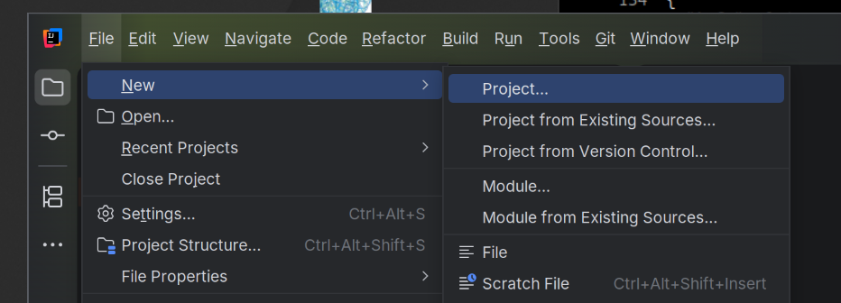
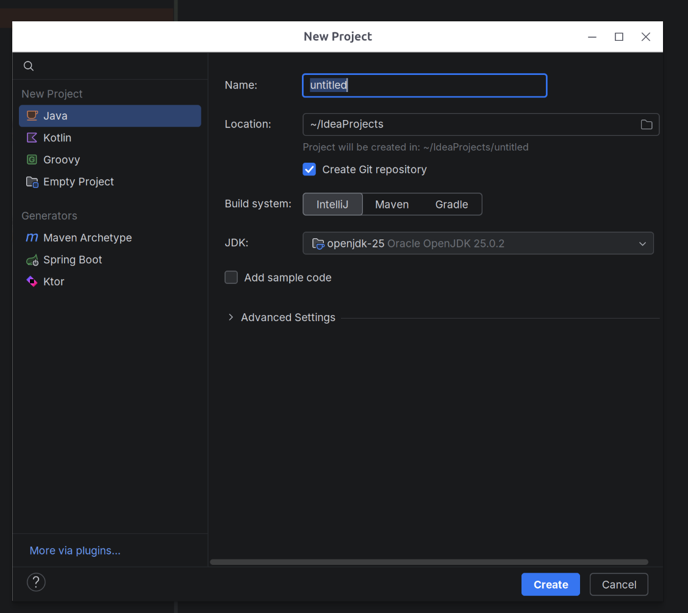
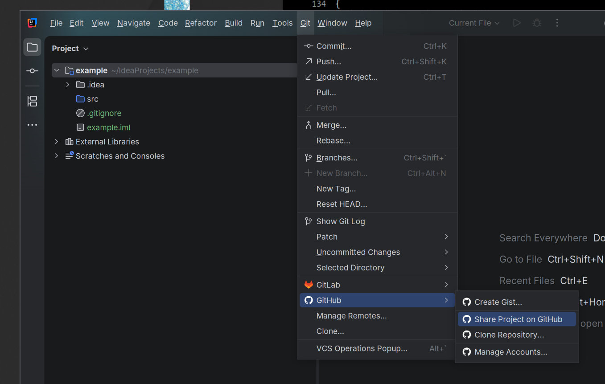
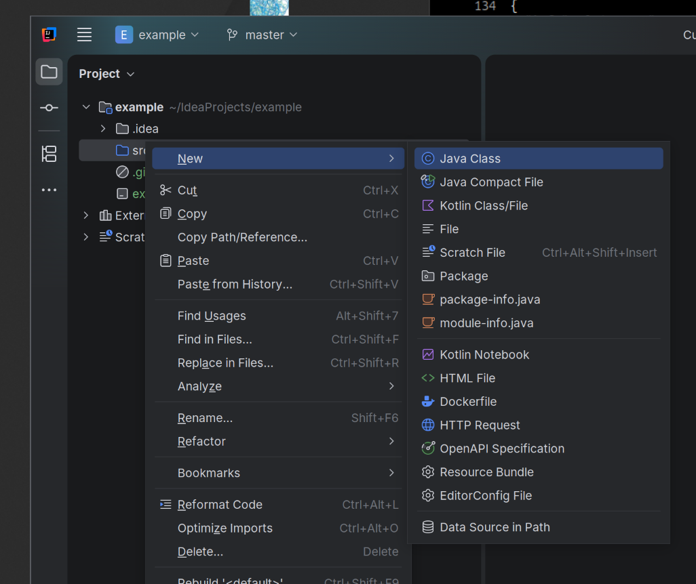

# Object Review Lab: Checklist

> **The goal:** set up a Java project in IntelliJ with GitHub, then solve two problems with objects: Weight on Other Planets and Gas Mileage.

## Step 1: Get Set Up

- [ ] Review the [Objects in Java Notes](#Data-Structures-and-Algorithms/Objects-in-Java-Notes).
- [ ] Open IntelliJ and go to **File → New → Project**.



- [ ] Name your project and make sure **Create Git repository** is checked. Then click **Create**.



- [ ] Go to **Git → GitHub → Share Project on GitHub**. Give it a name and click **Share**. Sign in to GitHub if it asks.



- [ ] Right-click your project's `src` folder and choose **New → Java Class**. Name it `Main`. When it asks, add the file to Git.



- [ ] Add a `main` method to `Main`. Print something and run it to make sure everything works.

```java
public static void main(String[] args){
    // Your code here
}
```

## Step 2: Weight on Other Planets

Ask for the user's weight on Earth, let them pick a planet, and show their weight there. Multiply their Earth weight by the planet's multiplier.

| Planet  | Multiplier |
| ------- | ---------- |
| Mars    | 0.38       |
| Venus   | 0.90       |
| Jupiter | 2.4        |

- [ ] Ask the user for their weight on Earth and save it.
- [ ] Print a numbered menu of planets.
- [ ] Ask the user to pick a planet.
- [ ] Calculate and print their weight on that planet.
- [ ] Test your program with each input below:

| Earth Weight | Selection | Expected Output |
| ----------- | ----------- | ----------- |
| `150` | `1` | `Your weight on Mars would be 57.0` |
| `150` | `2` | `Your weight on Venus would be 135.0` |
| `150` | `3` | `Your weight on Jupiter would be 360.0` |

Your output should look similar to this:

```
What is your weight on Earth? 150
1. Mars
2. Venus
3. Jupiter
Selection? 1
Your weight on Mars would be 57.0
```

<details>
<summary>Stuck on getting input?</summary>

Use a `Scanner`. Import it at the very top of your file, and pass it `System.in` so it reads from the keyboard.

```java
import java.util.Scanner;

Scanner scanner = new Scanner(System.in);
String line = scanner.nextLine();      // reads a line of text
double number = scanner.nextDouble();  // reads a number (double)
int choice = scanner.nextInt();        // reads a whole number
```

</details>

- [ ] Commit and push your code to GitHub.

## Step 3: Build the Automobile Class

- [ ] Create a new class called `Automobile`.
- [ ] Add these **private instance variables**:
  - [ ] `String make`: the make of the car
  - [ ] `String model`: the model of the car
  - [ ] `double mileage`: the car's gas mileage in miles per gallon
  - [ ] `double fuelTank`: the most gallons the tank can hold
  - [ ] `double fuel`: how many gallons are in the tank right now
- [ ] Write the constructor `Automobile(String mk, String mdl, double m, double fT)`. It sets every instance variable. The tank starts full.
- [ ] Write `fillUp(double gallons)`. It adds gas to the tank, but never fills past the tank's maximum.
- [ ] Write `takeTrip(double miles)`. It removes the gas used to drive that many miles.
- [ ] Write `reportFuel()`. It returns how much gas is left.

<details>
<summary>Stuck on takeTrip?</summary>

If a car gets `mileage` miles per gallon, how many gallons does it use to drive `miles` miles? Try it with easy numbers first: a car that gets 30 miles per gallon and drives 60 miles.

</details>

## Step 4: Test the Automobile Class

- [ ] Create a class called `TestAutomobile` and copy in this code:

```java
public class TestAutomobile {
    public static void main(String[] args) {

        // Creates a car with 35mpg and a max capacity of 8 gallons of gas.
        Automobile myCar = new Automobile("Toyota", "Prius", 35, 8);

        // Uses myCar to call takeTrip method. Passes argument of 100 miles driven
        myCar.takeTrip(100);

        // Uses myCar to call fillUp method. Passes argument of 2 gallons
        myCar.fillUp(2);

        // Uses myCar to call the reportFuel method. It returns a double of the amount of gas remaining in the tank
        double fuelLeft = myCar.reportFuel();

        // Prints the fuelLeft variable.
        System.out.println(fuelLeft);
    }
}
```

- [ ] Run it. It should print about `7.142857`.
- [ ] Add your own test: make a new car, call `fillUp(5)` right away, and print `reportFuel()`. The tank was already full, so it should print the tank's maximum, not more.
- [ ] Commit and push your code to GitHub.

## Step 5: Reflect and Submit

- [ ] Answer the reflection questions:
  - [ ] If we suddenly discovered 50 new planets and wanted to add them to your program, how tedious would it be to update your current code? How could you address this problem?
  - [ ] What currently happens to your program if a user types "one hundred" instead of the number 100 when asked for their weight? Why does this happen, and how might you fix it?
  - [ ] In the `Automobile` class, the instance variables (`make`, `model`, `mileage`, etc.) are declared as `private`. What does `private` mean in this context?
  - [ ] Explain in your own words what the method `Automobile(...)` does. Why is it necessary to pass arguments into it when we create a new `myCar` object?
- [ ] Make sure both programs are pushed to your GitHub repository.
- [ ] Attach your GitHub repository to Google Classroom.
- [ ] ✋ Show your instructor your GitHub repository with your programs.

## Extensions (Optional)

- [ ] Weight on Other Planets: also ask for the user's age in Earth years, and show their age in "local" years on the chosen planet. For example, 1 Earth year is about 0.53 Mars years, because Mars takes 687 days to orbit the sun.
- [ ] Gas Mileage: change `fillUp` to also take the price per gallon, like `fillUp(double gallons, double pricePerGallon)`. Keep a running total in a new instance variable `totalSpentOnGas`, and add a method that reports how much the car has cost to fill up.
