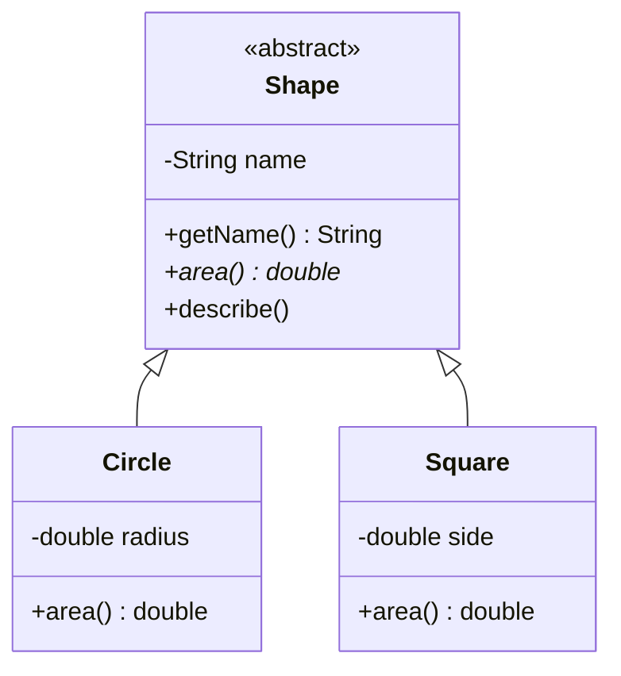

# Object-oriented Programming Principles Notes

Object-oriented programming (OOP) is built on **4 principles**. Each one helps you write code that is safer, easier to reuse, and easier to change.

| Principle | The big idea | In Java |
| --- | --- | --- |
| **Encapsulation** | Protect an object's data | `private` variables, `public` methods |
| **Abstraction** | Show *what* an object does, hide *how* | `abstract` classes and methods |
| **Inheritance** | Reuse code from a parent class | `extends`, `super` |
| **Polymorphism** | One method call, different behavior | `@Override`, a superclass variable holding a subclass object |

## Vocabulary

| Vocabulary | Description |
| ----------- | ----------- |
| superclass | the parent class that other classes extend |
| subclass | a child class that extends a superclass and inherits its methods |
| override | writing your own version of a method from the superclass |
| overload | writing several methods with the same name but different parameters |
| abstract class | a class you can't make objects from; a starting point for subclasses |

## Encapsulation

**Encapsulation** keeps an object's data `private`. Other code has to use the object's `public` methods, and those methods can protect the data.

```java
public class BankAccount {
    private double balance;

    public void deposit(double amount) {
        if (amount > 0) {
            balance += amount;
        }
    }

    public double getBalance() {
        return balance;
    }
}
```

```java
BankAccount account = new BankAccount();
account.deposit(50);
account.deposit(-1000);      // Ignored: deposit() only allows positive amounts
account.balance = 1000000;   // Error! balance is private
System.out.println(account.getBalance()); // 50.0
```

Nobody can set the balance to something wrong, because the only way in is through `deposit()`.

## Abstraction

**Abstraction** shows *what* an object can do and hides *how* it does it. You can call `area()` on any shape without knowing its formula.

In Java, an **abstract class** is a class you can't make objects from. An **abstract method** has no body, so every subclass must write its own.

```java
public abstract class Shape {
    private String name;

    public Shape(String name) {
        this.name = name;
    }

    public String getName() {
        return name;
    }

    // Every shape has an area, but each shape finds it differently.
    public abstract double area();

    public void describe() {
        System.out.println(name + " has an area of " + area());
    }
}
```

```java
Shape s = new Shape("Blob"); // Error! Shape is abstract.
```

## Inheritance

**Inheritance** lets a **subclass** reuse everything from its **superclass**. Use `extends` to inherit, and `super(...)` to call the superclass's constructor.

```java
public class Circle extends Shape {
    private double radius;

    public Circle(double radius) {
        super("Circle");   // Shape's constructor sets the name
        this.radius = radius;
    }

    @Override
    public double area() {
        return Math.PI * radius * radius;
    }
}
```

```java
public class Square extends Shape {
    private double side;

    public Square(double side) {
        super("Square");
        this.side = side;
    }

    @Override
    public double area() {
        return side * side;
    }
}
```

`Circle` and `Square` never write `getName()` or `describe()`. They inherit them from `Shape`.



The arrow points from the subclass to the superclass. `*` marks an abstract method.

## Polymorphism

**Polymorphism** means "many forms." A `Shape` variable can hold a `Circle` or a `Square`. When you call a method, Java runs the version that belongs to the real object.

```java
Shape[] shapes = { new Circle(1), new Square(3) };

for (Shape shape : shapes) {
    shape.describe();
}
```

```
Circle has an area of 3.141592653589793
Square has an area of 9.0
```

The loop doesn't know or care which shape it has. Each one uses its own `area()`. To add a `Triangle`, you'd write one new class and the loop wouldn't change at all.

**Overloading** is another kind of polymorphism: same method name, different parameters. Java picks the one that matches.

```java
public int add(int a, int b) { return a + b; }
public double add(double a, double b) { return a + b; }

add(2, 3);     // 5   (uses the int version)
add(2.5, 1.0); // 3.5 (uses the double version)
```

## Key Ideas

- **Encapsulation:** make variables `private`, and only change them through methods.
- **Abstraction:** use an `abstract` class to say what every subclass must do.
- **Inheritance:** use `extends` and `super(...)` to reuse code instead of copying it.
- **Polymorphism:** store subclass objects in a superclass variable or array, and let each one run its own version of a method.
