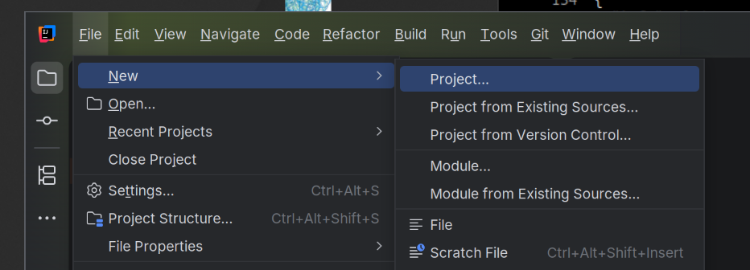
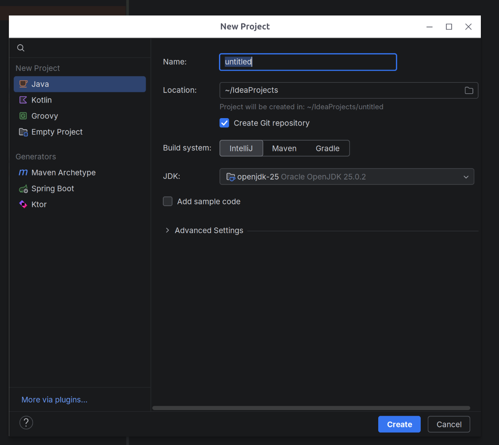
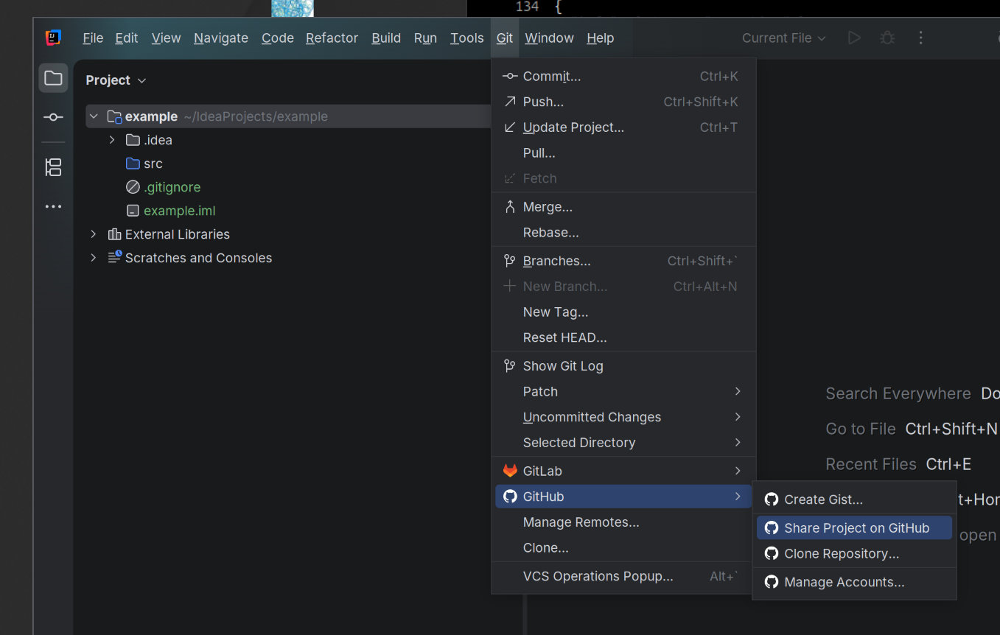
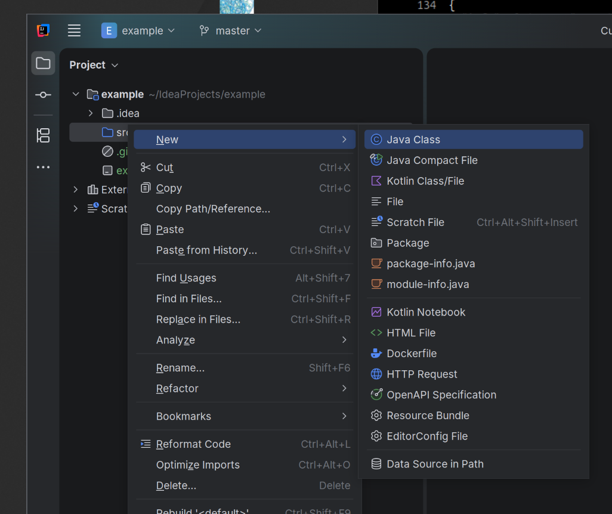

# Object Review Lab

## Objective

1. Review objects and classes
2. Learn how to use basic constructions in Java
3. Learn how to use IntelliJ with GitHub

## Vocabulary
| Vocabulary| Description |
| ----------- | ----------- |
| class | The template for an object |
| object | A variable of a custom type, as defined by the class |
| instance variable | Variables that belong to each object instance |
| constructor | A special method that instantiates instance variables when an object is created |

## Your Task

You will complete two problems to review creating objects.
- [Weight on Other Planets](#weight)
- [Gas Mileage](#gas-mileage)

## Setting Up a New Project

Before you get coding, you will need to set up a new project in IntelliJ. 

1. Launch IntelliJ and go to File-> New -> Project



2. Name your project and hit Create. Make sure "Create Git repository" is selected.



3. Go to Git -> GitHub -> Share Project on GitHub. Give it a name and hit Share. If you are not signed in with GitHub, follow the prompts to do so.



4. Right-click on your projects `src` folder and select New -> Java Class. Give it a name and hit Enter. Remember Java classes should always be capitalized like `Rectangle` or `Planet`. When prompted, add your file to Git. 



5. Remember to run code in Java, you must include a `main` method and **all methods must exist within a class**. By convention, create a class called `Main` that holds your `main` method. 

```java
public static void main(String[] args){
    // Your code here        
}
```

##  <a id="weight"></a>Weight on Other Planets

Write a program that will determine the user’s weight on another planet. The program should ask the user to enter their weight (on Earth) via the keyboard and then present a menu of planets to choose. Then the user will select one of the planets and the program will display their weight on the planet. 

> You can write this entire program in the `main` method if you choose to. You could also design a class.

To find their new weight, multiply their Earth weight by the values in the table (or look up values for other planets)

| Planet  | Multiplier |
| ------- | ---------- |
| Mars    | 0.38       |
| Venus   | 0.90       |
| Jupiter | 2.4        |


A typical output screen will be similar to:
```
What is your weight on Earth? 150
1. Mars
2. Venus
3. Jupiter
Selection? 1
Your weight on Mars would be 57.0
```

Remember to get input from the user we can use a `Scanner` object shown below

```java
Scanner scanner = new Scanner();
String line = scanner.nextLine(); // gets any characters as a string
double number = scanner.nextDouble(); // gets any characters as a number(double)
```

##  <a id="gas-mileage"></a>Gas Mileage Simulation

Create a class `Automobile` with the **private instance variables**:

- `String make`: Describes the make of the car
- `String model`: Describes the model of the car
- `double mileage`: Represents the car's gas mileage in miles per gallon
- `double fuelTank`: Represents the maximum capacity of the car's fuel tank in gallons
- `double fuel`: Represents the car's current fuel level in gallons 

`Automobile` also has the following **methods**:
- `Automobile(String mk, String mdl, double m, double fT)`: This constructor should set all of the instance variables. Assume the tank is full.
- `fillUp(double gallons)`: Adds `gallons` gallons of fuel to the tank. If a user tries to overfill the tank, only fill it to its maximum capacity.
- `takeTrip(double miles)`: Removes gas from the tank as result of driving a `miles` miles.
- `reportFuel()`: Returns how much fuel is remaining in the car.

Test your `Automobile` class by creating a `TestAutomobile` class as follows:

```java
public class TestAutomobile {  
    public static void main(String[] args) {  
  
		// Creates a car with 35mpg and a max capacity of 8 gallons of gas. 
        Automobile myCar = new Automobile("Toyota", "Prius", 35, 8);  
  
		// Uses myCar to call takeTrip method. Passes argument of 100 miles driven  
	    myCar.takeTrip(100);  
	    
        // Uses myCar to call fillUp method. Passes argument of 2 gallons  
        myCar.fillUp(2);  
  
        // Uses myCar to call the reportFuel method. It returns a double of the amount of gas remaining in the tank  
        double fuelLeft = myCar.reportFuel();  
  
        // Prints the fuelLeft variable. For this example, it is equal to 7.14285714286
        System.out.println(fuelLeft);  
    }  
}
```

## Tips, Tricks, and Resources
- [W3 Schools](https://www.w3schools.com/java/)

## Extensions
1. For Weight on Other Planets: expand the program to ask for the user's age in Earth years, and then calculate their age in "local" years on the chosen planet based on its orbital period (e.g., 1 Earth year = ~0.53 Mars years, because Mars takes 687 days to orbit the sun).
2. For Gas Mileage Simulation: update the `fillUp` method to accept the current price of gas per gallon (e.g., `fillUp(double gallons, double pricePerGallon)`).  Keep a running total in a new instance variable totalSpentOnGas and add a method to report how much money the car has cost the driver over time.

## Reflection Questions
1. If we suddenly discovered 50 new planets and wanted to add them to your program, how tedious would it be to update your current code? How could you address this problem?
2. What currently happens to your program if a user types "one hundred" instead of the number 100 when asked for their weight? Why does this happen, and how might you fix it?
3. In the `Automobile` class, the instance variables (`make`, `model`, `mileage`, etc.) are declared as `private`. What does `private` mean in this context?
4. Explain in your own words what the method `Automobile(...)` does. Why is it necessary to pass arguments into it when we create a new `myCar` object?

## How to Submit

Attach your GitHub repository to Google Classroom. Then, show your instructor your GitHub repository with your programs in class. You will also need to answer the reflection questions.

## Rubric
- **20 points** - All required items are present.
- **0 points** - Task was not attempted to completion or student should reattempt.