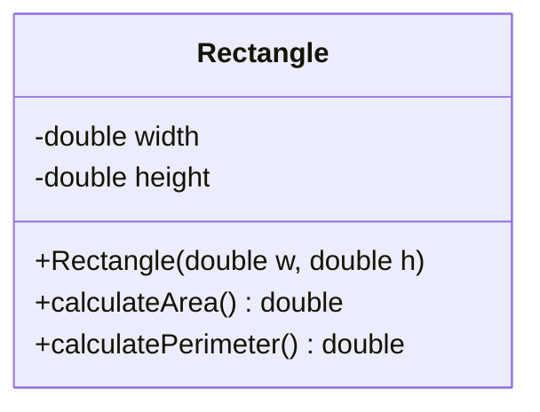
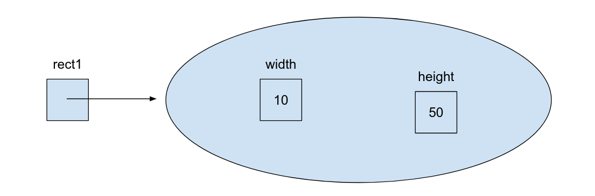
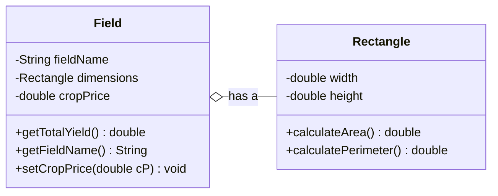
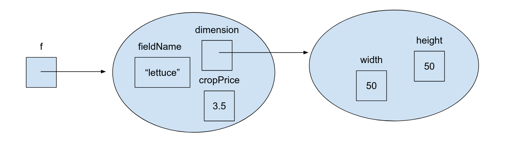
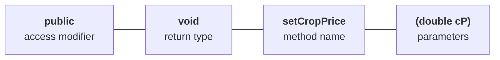
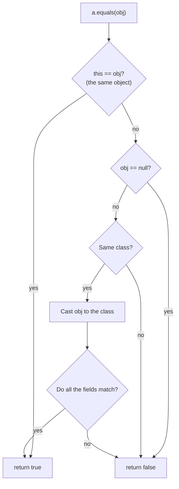
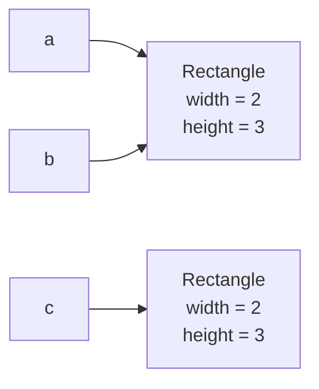
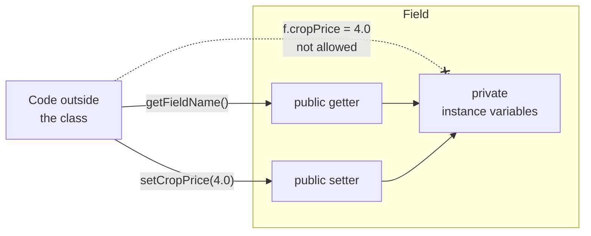

# Objects in Java Notes

<tabs>
<tab title="Grade Level">

Let's review some basic vocabulary.

| Vocabulary| Description |
| ----------- | ----------- |
| class | The template for an object |
| object | A variable of a custom type, as defined by the class |
| instance variable | Variables that belong to each object instance |
| constructor | A special method that instantiates instance variables when an object is created |
| instance method | A method that belongs to the instance of a class |


## Rectangle Example

Here is a class `Rectangle.java`. It has two **instance variables** `width` and `height`. It has one **constructor** and two **instance methods**, `calculateArea` and `calculatePerimeter`. 

```java
public class Rectangle {
    // Instance variables
    private double width;
    private double height;

    // Constructor
    public Rectangle(double w, double h) {
        width = w;
        height = h;
    }

    // Instance method 1
    public double calculateArea() {
        return width * height;
    }

    // Instance method 2
    public double calculatePerimeter() {
        return 2 * (width + height);
    }
}
```

**Instance variables** are defined in the class with their **access modifier**, **variable type** and name. There are three possible access modifiers, but we almost always defined instance variables with `private`. Instance variables can be of any type, including objects. 

In Java, **constructors** are defined with an access modifier, name of class, and whatever parameters you want. You can have as many constructors as you want as long as they have different parameters.

Then, **instance methods** are defined. We will get to how to construct a method header below.

A **class diagram** shows the same class at a glance: the name on top, then the instance variables, then the constructor and methods. `-` means `private` and `+` means `public`.



Now that we have a class, we can **instantiate** it.

```java
Rectangle rect1 = new Rectangle(10, 50);
```

Notice how the constructor and the keyword **new** were called when creating a new `Rectangle`. In memory, this would look like:



Now that we have a rectangle, we can call instance methods on it(because it is an instance of a class). Let's call the instance method `calculateArea()`.  

```java
System.out.println(rect1.calculateArea());
```

`calculateArea()` returns a double(the width of the rectangle * the height of the rectangle), so this will print 500.0.

Notice how we called `calculateArea()` on the instance of `rect1`. If we tried to call `calculateArea()` on its own, it would error since it is an **instance method**.  

## Field Example

Let's add to our previous example by creating the file `Field.java`.

```java
public class Field {
    private String fieldName;
    private Rectangle dimensions;
    private double cropPrice;

    public Field(String fN, Rectangle d, double cP) {
        fieldName = fN;
        dimensions = d;
        cropPrice = cP;
    }

    public double getTotalYield() {
        return dimensions.calculateArea() * cropPrice;
    }

    public String getFieldName() {
        return fieldName;
    }

    public void setCropPrice(double cP){
        cropPrice = cP;
    }
}
```

This is an example of a *has-a* relationship as `Field` has a `Rectangle` as its instance variable. In a class diagram, a has-a relationship is drawn as an arrow with a diamond on the side of the class that does the having.



```java
Field f = new Field("lettuce", new Rectangle(50,50), 3.50);
```



`String` and `Rectangle` are both classes so rather than existing inside the address space associated with `f`, `f` just stores the memory address of the other classes.

Look at the method `getTotalYield()` in the class. This method calls `calculateArea()` which is an instance method of `Rectangle` and is called on an instance of `Rectangle`(`dimensions`). Inside the class we can refer to instance variables by their names, in this case `dimensions`. 

## Instance Methods

Let's take a look at how to declare an instance method. 

A method header has 4 parts(it really has 5 but we aren't going to worry about the 5th option right now). 
1. **Access Modifier**: this is a special keyword used to define the scope of the method. `public` methods can be accessed outside the class while `private` methods can only be accessed inside the class.
2. **Return Type**: the type of variable that is returned by the function. If there is nothing to return the return type is `void`. 
3. **Method Name**: the name of the method you will use to refer to it later.
4. **Parameters**: any parameters that will be passed to the method.



Let's break down a method header, for example: `public String getFieldName()`
- Access Modifier(`public`): the method will be accessible outside the class
- Return Type(`String`): the method will return a String
- Method Name(`getFieldName`): the name of the method
- Parameters(`()`): there are no parameters

Let's break down another method header: `public void setCropPrice(double cP)`
- Access Modifier(`public`): the method will be accessible outside the class
- Return Type(`void`): the method will return nothing
- Method Name(`setCropPrice`): the name of the method
- Parameters(`(double cP)`): the new price will be passed to the method as a double

### Special Methods

There are two kinds of special methods you will see over and over in Java classes: `toString()` and `equals()`. Both are inherited from the `Object` class.

#### toString()

The `toString()` method returns a String representation of a class. This method is automatically called when an object is printed. Typically it returns a string in the form `className(parameter1, parameter2, ...)`.

#### equals()

The `equals(Object obj)` method returns `true` if the parameter is equivalent to the current instance of the class and `false` otherwise. Typically this method follows the following steps:

1. Use the `@Override` annotation to ensure you are correctly overriding the method from the Object class.
2. Check for reference equality: `if (this == obj) return true;`.
3. Check for null: `if (obj == null) return false;`.
4. Check that the object being compared is of the correct class (using `instanceof` or `getClass()`).
5. Cast the object to the correct type.
6. Compare the relevant fields (use == for primitives and the `equals()` method or `Objects.equals()` utility for object types).



#### `==` vs. `equals()`

For objects, `==` checks whether two variables hold the **same address**. `equals()` checks whether two objects hold the **same values**.

```java
Rectangle a = new Rectangle(2, 3);
Rectangle b = a;                    // b points to the same object as a
Rectangle c = new Rectangle(2, 3);  // c points to a different object with the same values
```



| Expression | Result | Why |
| --- | --- | --- |
| `a == b` | `true` | Same object |
| `a == c` | `false` | Different objects |
| `a.equals(c)` | `true` | Same values (if `Rectangle` overrides `equals()`) |

## A Note on Access Modifiers 

Notice that throughout these notes we have defined our instance variables as `private` and our methods as `public`. This is typical for defining methods and variables but not required. 

It is generally considered insecure to create `public` instance variables so we often make them private. If you want your variables value to be accessible, we make a method to return the value called a "getter". If you want your variable to be modifiable, then you would create a method to change the value. This is colloquially referred to as a "setter". 



Most methods you create will be `public` as they are intended to be referenced outside the class. Any method that is not intended to be used outside the class should be made `private`. These internal methods are called **helper methods**.

</tab>
<tab title="Explain It Like I'm 10">

## Words to Know

- **Class:** a blueprint for making something.
- **Object:** one actual thing made from the blueprint.
- **Instance variable:** information each object keeps for itself, like a rectangle's width.
- **Constructor:** the code that runs when a new object is made, to fill in its information.
- **Method:** something an object can **do**, like calculate its area.

## Blueprints and Houses

A blueprint says every house has a door and some windows, but you can't live in a blueprint. You use it to **build** houses.

- The **class** is the blueprint.
- An **object** is a house built from it. You can build as many as you want, and each can be different.

## Making a Class

```java
public class Rectangle {
    private double width;    // Each rectangle has its own width and height
    private double height;

    public Rectangle(double w, double h) {   // Constructor: runs when a rectangle is made
        width = w;
        height = h;
    }

    public double calculateArea() {          // Method: something a rectangle can do
        return width * height;
    }
}
```

## Making and Using an Object

Use `new` to build an object, then use a dot to ask it to do something:

```java
Rectangle rect1 = new Rectangle(10, 50);
System.out.println(rect1.calculateArea());   // 500.0
```

`calculateArea()` needs a rectangle to work on, so you always call it **on** an object, like `rect1.calculateArea()`.

## Objects Inside Objects

A `Field` can **have** a `Rectangle` as one of its variables. This is called a *has-a* relationship. The field doesn't hold the whole rectangle inside it. It holds the rectangle's **address** in memory, like writing down where a house is instead of carrying the house around.

## Reading a Method Header

`public double calculateArea()` has four parts:

| Part | Example | Means |
| --- | --- | --- |
| Access modifier | `public` | Who can use it |
| Return type | `double` | What it gives back (`void` means nothing) |
| Name | `calculateArea` | What you call it |
| Parameters | `()` | What you give it |

## Keeping Things Private

Instance variables are usually `private`, so only the class itself can change them. To let others read or change a value, the class adds small methods:

- A **getter**, like `getFieldName()`, hands back a value.
- A **setter**, like `setCropPrice(4.00)`, changes a value.

## Two Special Methods

- `toString()` turns an object into text. Java uses it automatically when you print an object.
- `equals()` decides whether two objects count as the same, like two rectangles with the same width and height.

</tab>
<tab title="Just the Highlights">

## Key Ideas

- A **class** is a blueprint. An **object** is an instance of it, made with `new`.
- **Instance variables** belong to each object and are usually `private`.
- A **constructor** has the class's name and no return type. You can have several, as long as their parameters differ.
- **Instance methods** are called on an object: `rect1.calculateArea()`.
- A variable holding an object stores a **reference** (its memory address), not the object itself.
- *Has-a*: one class can have another class as an instance variable.

## The Pattern

```java
public class Rectangle {
    private double width;                       // Instance variables
    private double height;

    public Rectangle(double w, double h) {      // Constructor
        width = w;
        height = h;
    }

    public double getWidth() { return width; }  // Getter
    public void setWidth(double w) { width = w; }  // Setter

    public double calculateArea() {             // Instance method
        return width * height;
    }

    @Override
    public String toString() {                  // Used when you print the object
        return "Rectangle(" + width + ", " + height + ")";
    }
}
```

## Method Headers

`access returnType name(parameters)`, like `public void setCropPrice(double cP)`. Use `void` when nothing is returned.

## equals()

1. `@Override public boolean equals(Object obj)`
2. `if (this == obj) return true;`
3. `if (obj == null || getClass() != obj.getClass()) return false;`
4. Cast: `Rectangle other = (Rectangle) obj;`
5. Compare fields: `==` for primitives, `equals()` or `Objects.equals()` for objects.

## Watch Out For

- Using `==` to compare objects. It checks whether two references point to the **same** object, not whether they're equal. Use `equals()`.
- Giving a constructor a return type, like `public void Rectangle(...)`. That makes it a regular method, not a constructor.
- Calling an instance method without an object, like `calculateArea()` from outside the class.
- Making instance variables `public`. Use getters and setters instead.

</tab>
</tabs>
