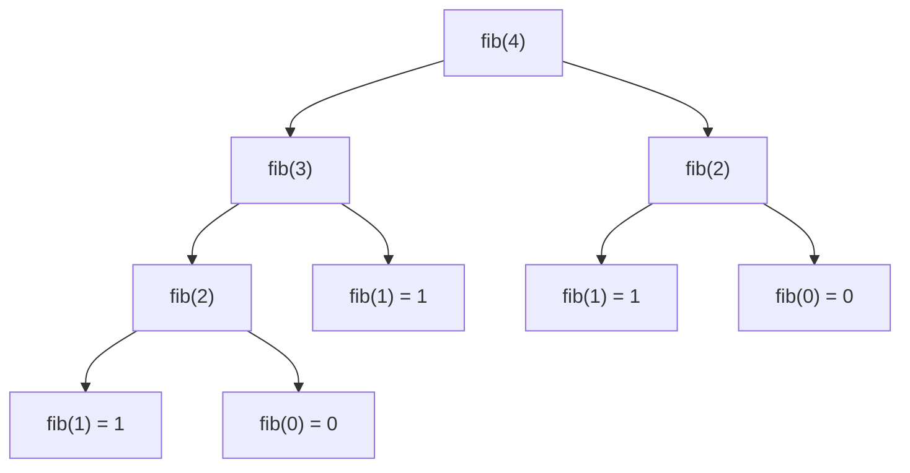
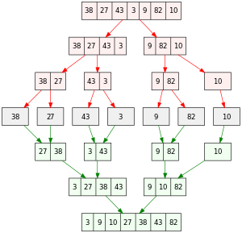
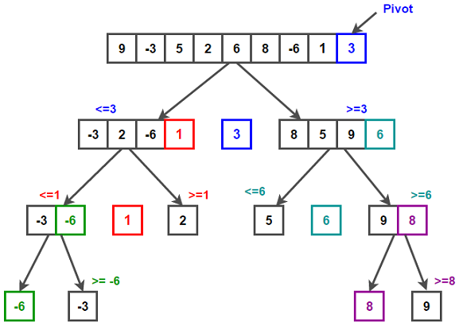

# Recursion Refresher Notes

Merge sort and quick sort are both **recursive**. Use these notes to brush up on recursion before you write them.

## Vocabulary

| Vocabulary | Description |
| ----------- | ----------- |
| recursion | when a method calls itself to solve a smaller version of the same problem |
| base case | a problem so small you already know the answer; it stops the recursion |
| recursive case | the part where the method calls itself on a smaller problem |
| iteration | repeating code with a loop until a condition is met |
| stack overflow | an error when too many method calls pile up on the call stack |
| divide and conquer | split a problem into smaller pieces, solve each piece, then combine the answers |

## What is Recursion?

**Recursion** is when a method calls itself to solve smaller versions of the same problem. Eventually the problem gets so small that you already know the answer. That's the **base case**. From there, each bigger problem gets solved, one by one, until the original problem is solved.

Every recursive method needs two things:

- **A recursive case:** the method calls itself on a smaller problem.
- **A base case:** a known answer that stops the recursion.

For example, here's how `power(2, 3)` finds $2^3$. Each call waits for the call below it, then multiplies its answer by 2:

```
power(2, 3) = 2 * power(2, 2)              = 2 * 4 = 8
              power(2, 2) = 2 * power(2, 1) = 2 * 2 = 4
                            power(2, 1) = 2 * power(2, 0) = 2 * 1 = 2
                                          power(2, 0) = 1   ← base case
```

## Iteration vs. Recursion

Both can solve the same problems. They just think about them differently. Here's how each one finds $2^5$:

| | Iteration | Recursion |
| --- | --- | --- |
| **How it works** | A loop repeats until a condition is met. | A method calls itself on a smaller problem. |
| **Finding $2^5$** | Start a counter at 0. Each time through the loop, multiply by 2 and add 1 to the counter. Stop when the counter is 5. | To find $2^5$, find $2^4$ and multiply by 2. To find $2^4$, find $2^3$, and so on. $2^0$ is 1, so work back up from there. |

## Example: Factorial

$n!$ ("n factorial") multiplies every whole number from 1 up to $n$:

$$5! = 5 \cdot 4 \cdot 3 \cdot 2 \cdot 1 = 120$$

<details>
<summary>Try it first: what are the recursive case and the base case for n!?</summary>

- **Recursive case:** $n! = n \cdot (n-1)!$. For example, $5! = 5 \cdot 4!$.
- **Base case:** $0! = 1$.

</details>

<div class="side-by-side">
<div>

**Iteratively** (with a loop)

```java
public static int factorial(int n) {
    int result = 1;
    for (int i = 1; i <= n; i++) {
        result *= i;
    }
    return result;
}
```

</div>
<div>

**Recursively**

```java
public static int factorial(int n) {
    if (n == 0) {
        return 1;                    // base case
    } else {
        return n * factorial(n - 1); // recursive case
    }
}
```

</div>
</div>

## What Happens Without a Base Case?

```java
public static int factorial(int n) {
    return n * factorial(n - 1);
}
```

Nothing ever stops it. `factorial(3)` calls `factorial(2)`, which calls `factorial(1)`, then `factorial(0)`, `factorial(-1)`, and on forever. Every call waits on the **call stack**, and none of them ever finish and get "popped off." Eventually the stack runs out of room and Java throws a `StackOverflowError`.

## Example: Fibonacci

In the Fibonacci sequence, each number is the sum of the two before it:

$$0, 1, 1, 2, 3, 5, 8, 13, \ldots$$

So $f(n) = f(n-1) + f(n-2)$. This one has **two** base cases: $f(0) = 0$ and $f(1) = 1$.

```java
public static int fibonacci(int n) {
    if (n == 0) {        // f(0) = 0
        return 0;
    } else if (n == 1) { // f(1) = 1
        return 1;
    }
    return fibonacci(n - 1) + fibonacci(n - 2);
}
```

Each call makes **two** more calls, so the recursion tree branches:



Notice `fib(2)` gets solved twice. As $n$ grows, this repeats a *lot* of work.

## Divide and Conquer

A **divide-and-conquer** algorithm solves a problem in three steps:

1. **Divide:** split the problem into smaller subproblems.
2. **Conquer:** solve each subproblem (usually recursively).
3. **Combine:** put the answers together to solve the original problem.

What does that remind you of? Recursion! Merge sort and quick sort both work this way.

### Merge Sort

1. **Divide:** split the array into two halves.
2. **Conquer:** recursively merge sort both halves.
3. **Combine:** merge the two sorted halves into one sorted array.



### Quick Sort

1. **Divide:** pick a **pivot**. Move everything smaller than the pivot to its left and everything bigger to its right.
2. **Conquer:** recursively quick sort the left side and the right side.
3. **Combine:** nothing to do! The pivot is already in its final spot, so once both sides are sorted, the whole array is sorted.



## Key Ideas

- A recursive method calls itself on a **smaller** problem.
- It always needs a **base case**, or it causes a stack overflow.
- Anything you can do with a loop, you can do with recursion, and the other way around.
- Merge sort and quick sort are **divide and conquer** algorithms: divide, conquer recursively, combine.
