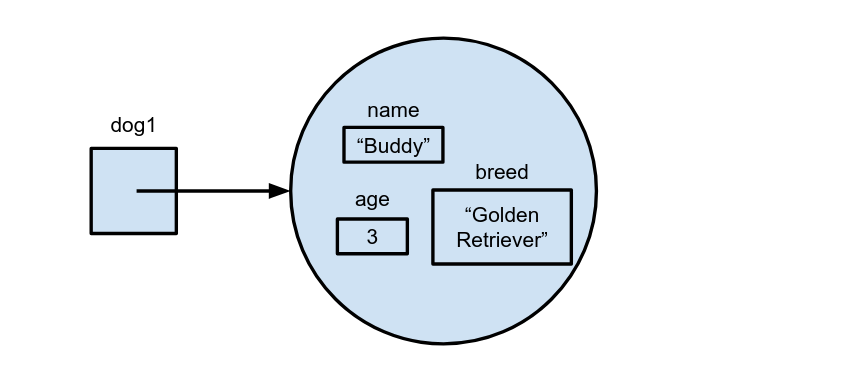
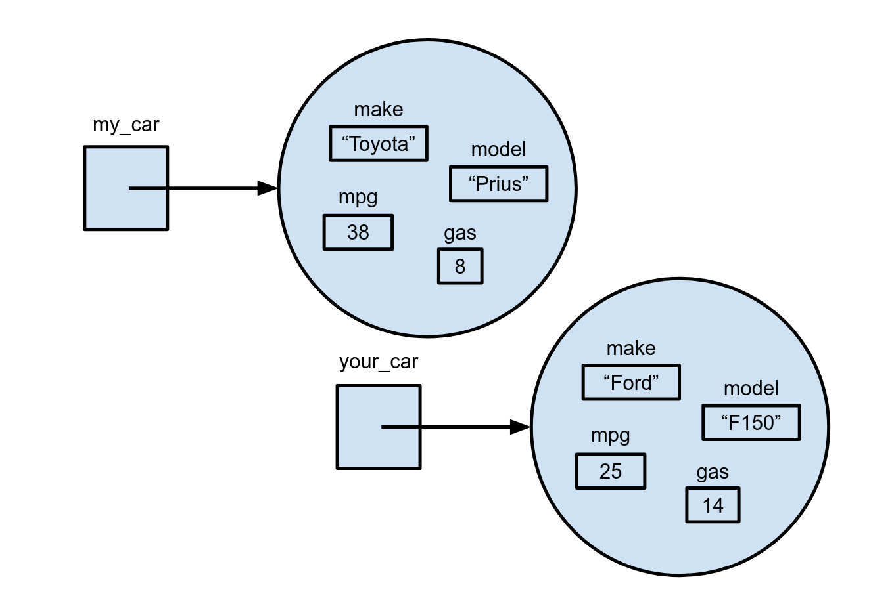
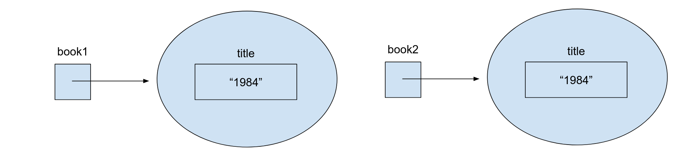
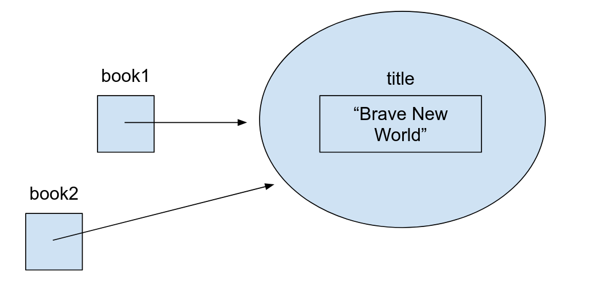

# Objects Notes

<tabs>
<tab title="Grade Level">

## Vocabulary

| Vocabulary| Description |
| ----------- | ----------- |
| class | The template, or blueprint, for an object |
| object | A variable of a custom type, as defined by the class. Also called an **instance** |
| instance variable | A variable that belongs to one specific object. Each object has its own copy |
| class attribute | A variable that belongs to the class itself, and is shared by every object of that type |
| constructor | A special method, `__init__()`, that sets up an object's instance variables when the object is created |
| instance method | A function that belongs to a class and is called on a specific object |
| `self` | The first parameter of every instance method. It refers to the object the method was called on |
| reference | A variable that points to an object in memory, instead of holding the object itself |

## A Thought Experiment

What if I wanted to create a program that stored information about a dog? I want to store the name, breed, and age of a dog.

My program might look something like this:
```python
name = "Buddy"
breed = "Golden Retriever"
age = 3
```

What if I wanted to make another dog that stored the same information? Now my program might look something like this.
```python
name_1 = "Buddy"
breed_1 = "Golden Retriever"
age_1 = 3

name_2 = "Luna"
breed_2 = "Husky"
age_2 = 5
```

or

```python
names = ["Buddy", "Luna"]
breeds = ["Golden Retriever", "Husky"]
ages = [3, 5]
```

Both versions get messy fast. With 100 dogs, we'd need 300 variables, or three lists that we have to keep in the exact same order. If I know what information and actions every dog should have, is there a way to define my own data type?

## Classes and Objects

By writing **classes** you are creating a blueprint for variables of type **object**, also called **instances**. Each **object** has its own set of **instance variables**, and **methods** that belong to it. This way you can easily store and manipulate information in your own custom data type.

Thinking about our Dog example from above, I could create a new class `Dog`.
```python
class Dog:
    # The __init__ method initializes the object's attributes
    def __init__(self, name, breed, age):
        self.name = name
        self.breed = breed
        self.age = age
```

To create a class you start with the header `class ClassName:`. By convention, class names are capitalized, like `Dog` or `BankAccount`.

### Constructors

Inside our class, we can then create a special method called a **constructor**. This method, defined as `def __init__(self, ...)`, is automatically called when you create a new instance of a class. It defines and initializes all of our **instance variables**: the variables that belong to an instance of a class.

To create a new instance of type `Dog` (an **object**), we call its constructor by using the class name like a function.
```python
dog1 = Dog("Buddy", "Golden Retriever", 3)
```

Notice that we pass in three values, even though `__init__` has four parameters. Python fills in `self` automatically with the new object.

In memory, our dog would look like:


To create another dog, I can just call the constructor again:
```python
dog2 = Dog("Luna", "Husky", 5)
```

Now, our memory diagram would look like:


**Notice** how each instance of `Dog` has its own `name`, `breed`, and `age`, and they're different. This is what it means to be an **instance variable**.

### Instance Variables

To access the instance variables from outside the class, we use the name of the object, a dot, and the variable's name.
```python
print(dog1.name)  # Buddy
print(dog2.breed) # Husky
```
If I wanted to update the `age` variable, I could add to it with:
```python
dog1.age += 1
print(dog1.age) # 4
```

Inside the class, I access them using the `self` keyword. `self.age` means "the `age` of whichever dog this method was called on."
```python
class Dog:
    def __init__(self, name, breed, age):
        self.name = name
        self.breed = breed
        self.age = age

    def have_birthday(self):
        self.age += 1
```

### Class Attributes

**Instance variables** belong to instances of a class. **Class attributes** are the same across all instances.

Say I wanted to store the species of dog. Since all dogs are the same species (*Canis familiaris*), I could create a **class attribute** to store the information. Class attributes are written directly inside the class, outside of any method, and without `self`. Look at the difference between instance variables and class attributes below.

```python
class Dog:
    # Class attribute: shared by all dogs
    species = "Canis familiaris"

    def __init__(self, name, age):
        # Instance variables: unique to each dog
        self.name = name
        self.age = age
```

Each instance shares class attributes.

```python
dog1 = Dog("Buddy", 3)
dog2 = Dog("Luna", 5)

print(dog1.species) # Canis familiaris
print(dog2.species) # Canis familiaris
print(Dog.species)  # Canis familiaris
```

### Instance Methods

Just like we have **instance variables**, there are also **instance methods**: functions that belong to an instance of a class.

For example, we can take a look at the class `BankAccount`:
```python
class BankAccount:
    # Constructor: the __init__ method initializes the instance variables
    def __init__(self, owner, starting_balance):
        self.owner = owner                 # Instance variable 1
        self.balance = starting_balance    # Instance variable 2

    # Instance method to add money to the account
    def deposit(self, amount):
        if amount > 0:
            self.balance += amount
            print(f"Deposited ${amount:.2f}. New balance is ${self.balance:.2f}.")
        else:
            print("Deposit amount must be positive.")

    # Instance method to remove money from the account
    def withdraw(self, amount):
        if amount > self.balance:
            print(f"Insufficient funds! You only have ${self.balance:.2f}.")
        elif amount > 0:
            self.balance -= amount
            print(f"Withdrew ${amount:.2f}. New balance is ${self.balance:.2f}.")
        else:
            print("Withdrawal amount must be positive.")

    # Instance method to display the current state of the account
    def display_balance(self):
        print(f"Account Owner: {self.owner} | Current Balance: ${self.balance:.2f}")
```

Now we can create a new instance (object) of the `BankAccount` class:
```python
my_account = BankAccount("Alice", 100.00)
```

Then, we can call instance methods on that object.
```python
my_account.display_balance()  # Account Owner: Alice | Current Balance: $100.00
my_account.deposit(50.00)     # Deposited $50.00. New balance is $150.00.
my_account.withdraw(20.00)    # Withdrew $20.00. New balance is $130.00.
my_account.withdraw(200.00)   # Insufficient funds! You only have $130.00.
```

Notice that `self` is the first parameter of every instance method header. **The `self` parameter is critical.** When you call `my_account.deposit(50.00)`, Python passes `my_account` in as `self`, and `50.00` in as `amount`. That's how the method knows *which* account's balance to change.

What do you think would happen if I tried to call `deposit()` on its own, like this?
```python
deposit(100.00)
```

This line would cause an error, since `deposit` is an **instance method** and must be called on an instance of the class. The same is true for **instance variables**: I can't use `owner` on its own without an instance of `BankAccount`, like `my_account.owner`.

### Methods That Return Values

Instance methods can `return` values, just like regular functions. A method that returns a value lets the rest of your program use the answer, instead of just printing it.

```python
class BankAccount:
    def __init__(self, owner, starting_balance):
        self.owner = owner
        self.balance = starting_balance

    def can_afford(self, price):
        return self.balance >= price

my_account = BankAccount("Alice", 100.00)
if my_account.can_afford(60.00):
    print("Purchase approved!")
```

### `__str__()`

There are a few special instance methods that Python calls automatically in different situations. Their names start and end with two underscores. One example is the **constructor**, `__init__()`, which we talked about above. Another is `__str__()`.

`__str__()` converts your object into a string. It must **return** a string (not print it), and is typically in the form `ClassName(var=value, ...)`. Python calls it automatically when you print an object, or pass it to `str()`.

Without `__str__()`, printing an object shows something unhelpful, like `<__main__.Dog object at 0x7f3a2c1b9d30>`. With it:

```python
class Dog:
    def __init__(self, name, breed, age):
        self.name = name
        self.breed = breed
        self.age = age

    def __str__(self):
        return f"Dog(name={self.name}, breed={self.breed}, age={self.age})"

dog1 = Dog("Buddy", "Golden Retriever", 3)
print(dog1)  # Dog(name=Buddy, breed=Golden Retriever, age=3)
```

### Lists of Objects

Objects can be stored in lists, just like any other value. This lets you loop through many objects and treat each one the same way.

```python
dogs = [
    Dog("Buddy", "Golden Retriever", 3),
    Dog("Luna", "Husky", 5),
    Dog("Max", "Beagle", 1),
]

for dog in dogs:
    print(f"{dog.name} is {dog.age} years old.")
```

## References and Copies

### Two Names for the Same Object

Let's take a look at the following code.

```python
class Book:
    def __init__(self, title):
        self.title = title

book1 = Book("1984")
book2 = book1
```

You would think the memory diagram would look something like this, with two separate books:



But in reality, it looks something like this. A variable holds a **reference** to an object, not the object itself. `book2 = book1` copies the reference, so both variables point to the **same** object. No copy of the book is made at all.


Knowing that, what will the following code print out?

```python
book2.title = "Brave New World"
print(book1.title)
```

The program will print out `Brave New World`, because there is only one book, and the memory diagram would look like:



### Shallow and Deep Copies

To get two separate objects (our first diagram), we need to actually make a copy. Python's `copy` module has two ways to do it:

```python
import copy  # Import the copy module from the default Python modules

book2 = copy.copy(book1)      # Shallow copy
book3 = copy.deepcopy(book1)  # Deep copy
```

Now our memory diagram would look like:


For a simple object like `Book`, both work the same. The difference shows up when an object holds **other** objects, like a list:

- A **shallow copy** (`copy.copy`) makes a new object, but anything inside it, like a list, is still **shared** with the original.
- A **deep copy** (`copy.deepcopy`) copies the object **and** everything inside it, so nothing is shared.

```python
import copy

class Dog:
    def __init__(self, name, tricks):
        self.name = name
        self.tricks = tricks   # A list

dog1 = Dog("Buddy", ["sit", "shake"])

shallow = copy.copy(dog1)
deep = copy.deepcopy(dog1)

dog1.tricks.append("roll over")

print(shallow.tricks)  # ['sit', 'shake', 'roll over']  <- shares dog1's list
print(deep.tricks)     # ['sit', 'shake']               <- has its own list
```

When you're not sure which one you need, use `copy.deepcopy()`. It's the only way to be certain the copy and the original are completely separate.

## Common Mistakes

- **Forgetting `self` in a method header.** `def deposit(amount):` causes an error when you call `my_account.deposit(50)`, because Python passes in two values: the object and `50`.
- **Forgetting `self.` on an instance variable.** Writing `balance += amount` instead of `self.balance += amount` changes a temporary variable, not the object's balance.
- **Printing instead of returning in `__str__()`.** `__str__()` must `return` a string.
- **Thinking `=` makes a copy.** `book2 = book1` makes a second name for the same object. Use the `copy` module to make a real copy.

</tab>
<tab title="Explain It Like I'm 10">

## Words to Know

- **Class:** a blueprint, or set of instructions, for making something.
- **Object:** one actual thing made from the blueprint. You can make as many as you want.
- **Instance variable:** a piece of information that each object keeps for itself, like a dog's name.
- **Class attribute:** a piece of information shared by every object made from the same blueprint.
- **Constructor:** the instructions that run when a new object is made, to fill in its information.
- **Method:** something an object can **do**, like a dog having a birthday.
- **`self`:** the way an object refers to itself, like saying "my."

## Why Do We Need Classes?

Say you're keeping track of the dogs at a dog park. For one dog, you might write:

```python
name = "Buddy"
breed = "Golden Retriever"
age = 3
```

That works for one dog. But what about 50 dogs? You'd need 150 variables! That gets messy fast.

It would be much easier if every dog's information stayed **together**, in one bundle. That's what a class lets you do.

## Blueprints and Houses

Think about a blueprint for a house. The blueprint says every house has a front door, a kitchen, and some bedrooms. But you can't live in a blueprint. You use it to **build** houses.

- The **class** is the blueprint.
- An **object** is a house built from that blueprint.

You can build lots of houses from the same blueprint, and each one can be painted a different color. In the same way, you can make lots of `Dog` objects from one `Dog` class, and each dog has its own name, breed, and age.

## Making a Class

Here's the blueprint for a dog:

```python
class Dog:
    def __init__(self, name, breed, age):
        self.name = name
        self.breed = breed
        self.age = age
```

- `class Dog:` starts the blueprint. Class names start with a capital letter.
- `__init__` is the **constructor**. It's the set of instructions that runs every time a new dog is made. It fills in that dog's information.
- `self` means "this dog." So `self.name = name` means "**this dog's** name is the name we were given."

## Making Objects

Now we can use the blueprint to make dogs:

```python
dog1 = Dog("Buddy", "Golden Retriever", 3)
dog2 = Dog("Luna", "Husky", 5)
```

Each dog keeps its own information. Think of each one like a labeled box with its own stuff inside:


To look inside a box, use a dot:

```python
print(dog1.name)   # Buddy
print(dog2.breed)  # Husky
```

`dog1.name` means "dog1's name." The dot works like an apostrophe-s.

## Things Every Dog Shares

Some information is the same for every dog. Every dog is the same species, so there's no reason for each dog to store it separately. Instead, we put it on the blueprint itself:

```python
class Dog:
    species = "Canis familiaris"     # Shared by every dog

    def __init__(self, name, age):
        self.name = name             # Each dog has its own
        self.age = age
```

That's a **class attribute**. It's like the street name in a neighborhood: every house on the street has the same one.

## Things Objects Can Do

Objects don't just hold information. They can also **do** things. These actions are called **methods**. Here's a bank account that can take in money and give it out:

```python
class BankAccount:
    def __init__(self, owner, starting_balance):
        self.owner = owner
        self.balance = starting_balance

    def deposit(self, amount):
        self.balance += amount

    def withdraw(self, amount):
        if amount > self.balance:
            print("Not enough money!")
        else:
            self.balance -= amount
```

To use a method, put a dot after the object's name:

```python
my_account = BankAccount("Alice", 100)
my_account.deposit(50)      # Alice now has 150
my_account.withdraw(20)     # Alice now has 130
```

When you write `my_account.deposit(50)`, Python secretly hands `my_account` to the method as `self`. That's how the method knows **whose** account to put the money in. If you have two accounts, depositing into one doesn't change the other.

## Giving Your Object a Name Tag

If you print an object, Python doesn't know what to show, so you get something confusing like `<__main__.Dog object at 0x7f3a2c1b9d30>`.

You can fix that by giving your class a `__str__()` method. It's like a name tag: it tells Python what to show when the object gets printed. It has to **return** the text, not print it.

```python
class Dog:
    def __init__(self, name, breed, age):
        self.name = name
        self.breed = breed
        self.age = age

    def __str__(self):
        return f"Dog(name={self.name}, breed={self.breed}, age={self.age})"

print(Dog("Buddy", "Golden Retriever", 3))   # Dog(name=Buddy, breed=Golden Retriever, age=3)
```

## Nicknames vs. Copies

Here's a tricky one. What do you think this prints?

```python
book1 = Book("1984")
book2 = book1
book2.title = "Brave New World"
print(book1.title)
```

It prints `Brave New World`! That's because `book2 = book1` **doesn't** make a second book. It just gives the same book a second name, like a nickname. When you change the book using one name, you see the change using the other name too, because there's only one book.


To make a real, separate copy, use the `copy` module:

```python
import copy
book2 = copy.deepcopy(book1)   # A brand new book with the same title
```

Now changing `book2` won't affect `book1`.

There's also `copy.copy()`, which makes a **shallow copy**. It makes a new object, but if the object has a list inside it, the two objects still share that same list. `copy.deepcopy()` copies everything, so when in doubt, use that one.

## Common Mistakes

- **Forgetting `self`.** Every method needs `self` as its first parameter, and every instance variable needs `self.` in front of it inside the class.
- **Printing in `__str__()`.** It needs to `return` the text instead.
- **Thinking `=` makes a copy.** It just makes a nickname. Use `copy.deepcopy()` for a real copy.

</tab>
<tab title="Just the Highlights">

## Key Ideas

- A **class** is a blueprint. An **object** (or **instance**) is one thing built from it.
- **Instance variables** (`self.name`) belong to one object. **Class attributes** are defined in the class body, without `self`, and are shared by all objects.
- `__init__(self, ...)` is the **constructor**. It runs automatically when you create an object, like `Dog("Buddy", "Golden Retriever", 3)`.
- **Instance methods** take `self` first. `obj.method(x)` passes `obj` in as `self` automatically.
- Access instance variables and methods with dot notation, like `dog1.name` or `my_account.deposit(50)`.

## The Pattern

```python
class Dog:
    species = "Canis familiaris"              # Class attribute: shared

    def __init__(self, name, age):            # Constructor
        self.name = name                      # Instance variables: per object
        self.age = age

    def have_birthday(self):                  # Instance method
        self.age += 1

    def __str__(self):                        # Called by print() and str()
        return f"Dog(name={self.name}, age={self.age})"

dog1 = Dog("Buddy", 3)
dog1.have_birthday()
print(dog1)          # Dog(name=Buddy, age=4)
print(dog1.species)  # Canis familiaris
```

## Special Methods

| Method | Called when | Must |
| ----------- | ----------- | ----------- |
| `__init__(self, ...)` | an object is created | set up instance variables (returns nothing) |
| `__str__(self)` | you `print()` an object or call `str()` on it | **return** a string |

## References and Copies

- Variables hold **references** to objects. `b = a` makes a second name for the **same** object, not a copy.
- `copy.copy(a)`: a **shallow copy**. A new object, but objects inside it (like lists) are still shared.
- `copy.deepcopy(a)`: a **deep copy**. A new object with new copies of everything inside it.

## Watch Out For

- A missing `self` parameter in a method header, which gives a "takes 1 positional argument but 2 were given" error.
- A missing `self.` on an instance variable, which changes a temporary variable instead of the object.
- Printing instead of returning in `__str__()`.
- Calling an instance method without an object, like `deposit(50)` instead of `my_account.deposit(50)`.

</tab>
</tabs>
