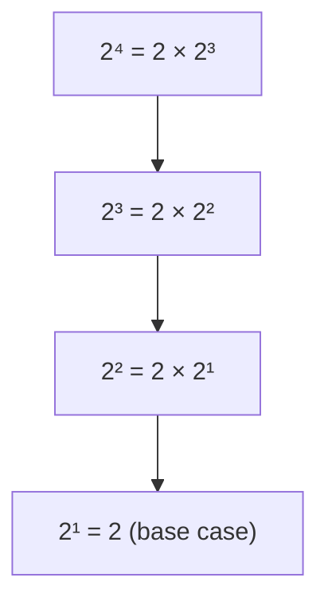
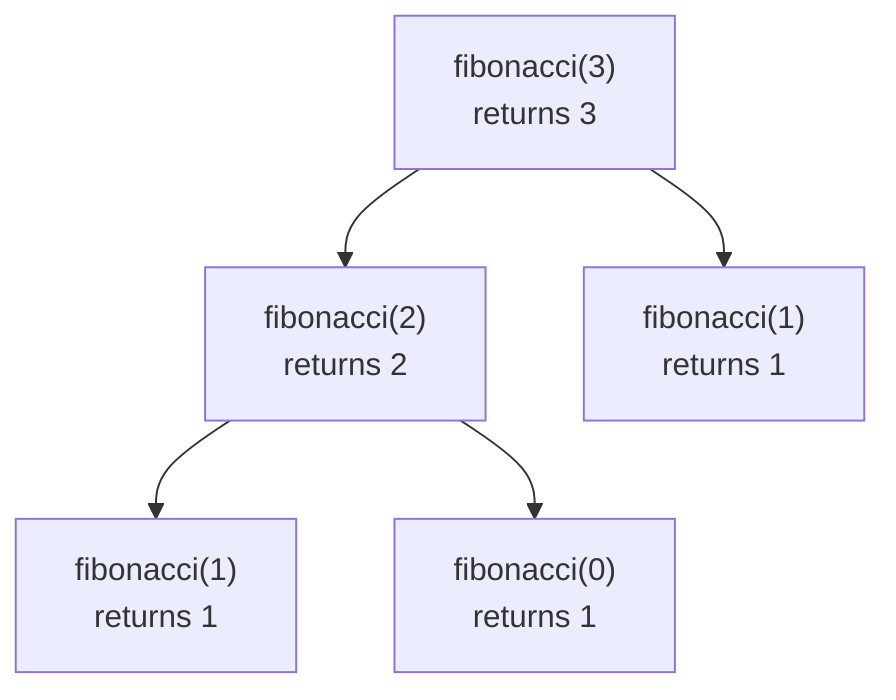

# Recursion Notes

<tabs>
<tab title="Grade Level">

## Vocabulary
| Vocabulary| Description |
| ----------- | ----------- |
| recursive function | a function that solves problems by calling itself |
| base case | the end case for a recursive function. Instead of calling the function again, we return a standard value we know |
| recursive case | a case for a recursive function where you call the function again on a smaller version of the problem |
| call stack | the data structure that keeps track of the function calls that are still running |
| stack frame | one entry on the call stack. It stores a single call's variables and where it left off |
| recursion tree | a diagram that shows every call a recursive function makes, and what each call returns |

## What are Recursive Functions?

Let's say I wanted to find the value of $2^4$. I could write a loop to solve this or I could use a **recursive process**. Using recursion I could rewrite $2^4$ as $2 \times 2^3$. Then I could rewrite $2^3$ as $2 \times 2^2$ and so on.



Eventually I will need to reach a stopping point. Let's say we know that $2^1 = 2$. This is an example of a **base case**. We can then work our way back up: $2^2 = 2 \times 2 = 4$, then $2^3 = 2 \times 4 = 8$, and finally $2^4 = 2 \times 8 = 16$.

Each **recursive function** has two cases:
- The **base case** where we know a case is a fixed value
- The **recursive case** where a function calls itself on a smaller version of the problem

In Python, our exponent example might look something like this.

```python
def power(a, b):
    if b == 1:
        return a
    else:
        return a * power(a, b-1)
```

You can see our **base case** is `a` when `b == 1`. Our **recursive case** is `a * power(a, b-1)` in all other cases.

If I were to call `power(2, 4)`, it would call `power(2, 3)` which would call `power(2, 2)` and so on until `power(2, 1)` returns 2. Then we would work our way backwards through the calls until we get back to `power(2, 4)`.

## How to Write a Recursive Function

1. **Find the smaller problem.** Ask yourself: how can I describe this problem using a smaller version of the same problem? For $2^4$, the smaller problem is $2^3$.
2. **Write the base case first.** What is the smallest input, where you already know the answer without any more work? Return that answer.
3. **Write the recursive case.** Call your function on the smaller problem, then use its answer to build the answer to the bigger one.
4. **Trust the recursion.** When you write the recursive case, assume your function already works for the smaller problem. You don't have to trace every call in your head.
5. **Test with small inputs first.** Try the base case, then one step above it, then larger inputs.

### Example: Counting Vowels

Recursion isn't just for numbers. Here's a function that counts the vowels in a string. The smaller problem is the same string without its first letter, `text[1:]`.

```python
def count_vowels(text):
    if text == "":
        return 0
    else:
        if text[0].lower() in "aeiou":
            first = 1
        else:
            first = 0
        return first + count_vowels(text[1:])
```

- **Base case:** an empty string has `0` vowels.
- **Recursive case:** check the first letter, then add the vowels in the rest of the string.

Calling `count_vowels("cat")` works like this:

```
count_vowels("cat") = 0 + count_vowels("at")
count_vowels("at")  = 1 + count_vowels("t")
count_vowels("t")   = 0 + count_vowels("")
count_vowels("")    = 0                       <- base case
```

Working back up: `0 + 0 = 0`, then `1 + 0 = 1`, then `0 + 1 = 1`. There is **1** vowel in `"cat"`.

## The Call Stack

Your computer keeps track of the function calls that are still running in a data structure called the **call stack**. Like a stack of plates, new items go on the top, and the top item is always the first one taken off.

Each time a function is called, a new **stack frame** is pushed onto the top of the stack. The frame remembers that call's variables and where it left off. When the function returns, its frame is popped off the stack, and its return value is handed to the call underneath it.

Here is the call stack for `power(2, 4)` at the moment the base case is reached:

```
power(2, 1)   returns 2                    <- top of the stack (last call made)
power(2, 2)   waiting on 2 * power(2, 1)
power(2, 3)   waiting on 2 * power(2, 2)
power(2, 4)   waiting on 2 * power(2, 3)   <- bottom (first call made)
```

Now the stack unwinds from the top down:
1. `power(2, 1)` returns `2` and is popped off.
2. `power(2, 2)` can finish: `2 * 2` returns `4`.
3. `power(2, 3)` can finish: `2 * 4` returns `8`.
4. `power(2, 4)` can finish: `2 * 8` returns `16`.

## Recursion Trees

A **stack diagram** shows the calls waiting at one moment. A **recursion tree** shows every call a function makes over the whole run. Trees are especially helpful when a function calls itself **more than once**, like the Fibonacci function in the first exercise below. Each call to `fibonacci(n)` calls `fibonacci(n-1)` **and** `fibonacci(n-2)`:



To read a tree, start at the bottom. The base cases return first, and each call adds up the answers of the calls below it. Notice that `fibonacci(1)` is calculated twice! For large inputs, this repeated work makes this version of Fibonacci very slow.

Drawing a recursion tree or a stack diagram is the best way to trace a recursive function by hand.

## Recursion vs. Loops

Anything you can solve with recursion, you can also solve with a loop. Here is `power` written both ways:

```python
# With a loop
def power_loop(a, b):
    result = 1
    for i in range(b):
        result = result * a
    return result

# With recursion
def power(a, b):
    if b == 1:
        return a
    else:
        return a * power(a, b-1)
```

- **Loops** are usually faster and use less memory, because they don't add a stack frame for every step.
- **Recursion** is often shorter and clearer when a problem is naturally made of smaller copies of itself, like nested folders, family trees, mazes, or fractals.

## Common Mistakes

- **No base case.** The function calls itself forever. Frames keep getting pushed onto the call stack until it runs out of room, and Python stops with a `RecursionError: maximum recursion depth exceeded`.
- **The problem doesn't get smaller.** Calling `power(a, b)` inside `power(a, b)` never reaches the base case. Every recursive call must move closer to the base case, like `b-1` or `text[1:]`.
- **Forgetting to `return`.** Writing `a * power(a, b-1)` without `return` calculates the answer, then throws it away. The function returns `None` instead.
- **Skipping past the base case.** If your base case is `n == 0` but your recursive call uses `n-2`, an odd number will skip right over 0 and keep going. Make sure every input eventually lands on a base case.

</tab>
<tab title="Explain It Like I'm 10">

## Words to Know

- **Recursion:** solving a big problem by solving a smaller version of the same problem.
- **Base case:** the "stop" rule. It's the smallest version of the problem, where you already know the answer.
- **Recursive case:** the "repeat" rule. Shrink the problem a little, and solve the smaller version the same way.
- **Call stack:** the computer's to-do pile. It keeps track of every function call that's still waiting for an answer.
- **Recursion tree:** a drawing of every call a function makes, and what each one returns.

## What is Recursion?

Imagine you're in a long line at a concert, and you want to know your place in line. You can't see the front, so you ask the person ahead of you, "What number are you?"

They don't know either, so they ask the person ahead of them. That person asks the next person, and so on, all the way up the line.

Eventually, the question reaches the first person in line. They don't need to ask anyone. They already know they're **number 1**.

Then the answers travel back down the line. Each person adds 1 to the answer they got: "They're 1, so I'm 2." "They're 2, so I'm 3." The answers keep coming back until one reaches you.

That's **recursion**. Every person followed the same rule: *ask the person ahead, then add 1.* Each question was a little smaller than the last, until one was easy enough to answer right away.

## The Two Rules

Every recursive function needs two rules:

1. **Base case: when do you stop?** The first person in line knows the answer without asking anyone.
2. **Recursive case: how do you make the problem smaller?** Everyone else asks the person ahead, then uses that answer to figure out their own.

Without a base case, the questions would never stop.

## An Example with Math

$2^4$ means four 2s multiplied together: $2 \times 2 \times 2 \times 2$.

Instead of doing it all at once, notice that $2^4$ is the same as $2 \times 2^3$. Now you only need $2^3$, which is a smaller version of the **same** problem.

- $2^3$ is $2 \times 2^2$.
- $2^2$ is $2 \times 2^1$.
- $2^1$ is just **2**. You already know that one, so it's the base case.

Now the answers travel back up, just like in the line:
- $2^2 = 2 \times 2 = 4$
- $2^3 = 2 \times 4 = 8$
- $2^4 = 2 \times 8 = 16$

Here's the same idea in Python:

```python
def power(a, b):
    if b == 1:                     # Base case: we know this answer
        return a
    else:                          # Recursive case: solve a smaller problem
        return a * power(a, b-1)
```

`power(2, 4)` calls `power(2, 3)`, which calls `power(2, 2)`, which calls `power(2, 1)`. That last call returns 2 right away, and the answers travel back up.

## Steps for Writing a Recursive Function

1. **Find the smaller problem.** What's a smaller version of the same question?
2. **Write the base case first.** What's the smallest input, where you already know the answer?
3. **Write the recursive case.** Solve the smaller problem, then use its answer.
4. **Trust that it works.** Assume the smaller problem gets solved correctly. Your job is just to handle one step.
5. **Test small inputs first.** Try the smallest input, then work your way up.

## Another Example: Sorting Through a Bag of Candy

Say you have a bag of candy, and you want to count how many pieces are chocolate.

Here's how to do it recursively: take **one** piece out and check whether it's chocolate. Then count the chocolate in the rest of the bag **the same way**. When the bag is empty, there's no chocolate left to count. That's the base case.

Counting the vowels in a word works the same way. Each letter is a piece of candy, and the vowels are the chocolate:

```python
def count_vowels(text):
    if text == "":                 # Empty word: 0 vowels
        return 0
    else:
        if text[0].lower() in "aeiou":
            first = 1              # The first letter is a vowel
        else:
            first = 0              # The first letter is not a vowel
        return first + count_vowels(text[1:])   # Count the rest of the word
```

`text[1:]` means "the word without its first letter." The word gets one letter shorter each time, until it's empty.

## The Call Stack: A Pile of Sticky Notes

How does the computer remember which calls are still waiting for an answer? Each time a function calls another function, the computer writes a sticky note and puts it **on top** of a pile:

```
power(2, 1): "Base case! The answer is 2."   <- top
power(2, 2): "Waiting, then 2 × answer"
power(2, 3): "Waiting, then 2 × answer"
power(2, 4): "Waiting, then 2 × answer"      <- bottom
```

The computer always works on the **top** note first. When a note gets its answer, the computer removes it and passes the answer to the note underneath. The pile shrinks until only the final answer is left: **16**.

## Recursion Trees: When a Function Calls Itself Twice

Some functions call themselves **twice** instead of once. When you draw out their calls, the drawing branches out like a tree.

In the Fibonacci exercise below, `fibonacci(3)` calls both `fibonacci(2)` **and** `fibonacci(1)`. Then `fibonacci(2)` makes two calls of its own:


The calls at the bottom finish first. Each one passes its answer up, and the call above adds them together.

## Loops or Recursion?

Think about climbing a staircase. A **loop** is like climbing one step at a time and counting as you go. **Recursion** is like saying, "Climbing 10 stairs is just climbing 1 stair, then climbing the other 9." Both get you to the top. Loops are usually faster for the computer, but recursion is a great fit for problems made of smaller copies of themselves, like folders inside of folders.

## Common Mistakes

- **No base case.** The computer keeps adding sticky notes until the pile gets too tall, and Python stops with a `RecursionError`.
- **The problem doesn't get smaller.** If you call the function with the exact same input, you'll never reach the base case. Shrink the problem every time.
- **Forgetting to `return`.** If a call figures out the answer but doesn't `return` it, the call underneath never gets it. Python gives back `None` instead.

</tab>
<tab title="Just the Highlights">

## Key Ideas

- A **recursive function** solves a problem by calling itself on a **smaller** version of the same problem.
- Every recursive function needs:
  - a **base case**: the smallest input, returned directly with no recursive call.
  - a **recursive case**: a call on a smaller input, whose answer is used to build the final answer.
- Every recursive call must move **closer to the base case**.
- Answers are built on the way **back up**, after the base case returns.

## The Pattern

The general shape, in pseudocode:

```python
def solve(problem):
    if problem is the smallest case:      # Base case
        return known_answer
    else:                                 # Recursive case
        return combine(problem, solve(smaller_problem))
```

For example:

```python
def power(a, b):
    if b == 1:
        return a
    else:
        return a * power(a, b-1)
```

Common ways to make a problem smaller:

| Type | Smaller version | Usual base case |
| ----------- | ----------- | ----------- |
| number | `n - 1` | `n == 0` or `n == 1` |
| string | `text[1:]` | `text == ""` |
| list | `items[1:]` | `items == []` |

## The Call Stack

- Each call pushes a **stack frame** with its own variables. A frame is popped when the call returns, and its value goes to the call below it.
- The **last call made is the first to finish.**
- `power(2, 4)` stacks four frames, from `power(2, 4)` down to `power(2, 1)`, then unwinds with 2 → 4 → 8 → 16.
- If there's no base case, or the input never shrinks, Python stops with a `RecursionError: maximum recursion depth exceeded`.

## Tracing

- **Stack diagram:** the calls waiting at one moment. Best when a function calls itself once.
- **Recursion tree:** every call over the whole run. Best when a function calls itself more than once, like `fibonacci(n-1) + fibonacci(n-2)`.
- Read a tree from the bottom up: base cases return first.
- A tree shows repeated work, like `fibonacci(1)` being calculated more than once.

## Recursion vs. Loops

- Anything recursive can be written as a loop.
- **Loops** are usually faster and use less memory: no new stack frame for each step.
- **Recursion** is clearer for problems made of smaller copies of themselves, like nested folders, trees, mazes, and fractals.

## Watch Out For

- A missing base case, or one the input can skip past, like `n-2` skipping over `0`.
- A recursive call that doesn't shrink the problem.
- Forgetting to `return` the recursive call's result, which makes the function return `None`.

</tab>
</tabs>

## Practice

Try these on your own first. For each one, ask yourself: **What is my base case? What is my recursive case?**

### Exercise

Write a **recursive function** to calculate the n-th value of the Fibonacci sequence. Think about what your **base case** and your **recursive case** must be.

| Input | Output |
| ----------- | ----------- |
| fibonacci(0) | 1 |
| fibonacci(1) | 1 |
| fibonacci(2) | 2 |
| fibonacci(4) | 5 |
| fibonacci(7) | 21 |


<details>
<summary>Click here to view the answer</summary>

```python
def fibonacci(n):
    if n == 0 or n == 1:
        return 1
    else:
        return fibonacci(n-1) + fibonacci(n-2)
```

Our **base case** is returning 1 when `n == 0` or `n == 1`. Our **recursive case** is `fibonacci(n-1) + fibonacci(n-2)`.

</details>

### Exercise

Given `n` of 1 or more, return the factorial of `n`, which is `n * (n-1) * (n-2) ... 1`. Write a function to compute the results recursively.

| Input | Output |
| ----------- | ----------- |
| factorial(1) | 1 |
| factorial(2) | 2 |
| factorial(4) | 24 |
| factorial(7) | 5040 |


<details>
<summary>Click here to view the answer</summary>

```python
def factorial(n):
    if n == 1:
        return 1
    else:
        return n * factorial(n-1)
```

Our **base case** is returning 1 when `n == 1`. Our **recursive case** is `n * factorial(n-1)`.

</details>

### Exercise

We want to calculate the number of chicken wings present for `n` chickens. Write a recursive function to find the number of wings.

| Input | Output |
| ----------- | ----------- |
| wings(0) | 0 |
| wings(2) | 4 |
| wings(4) | 8 |
| wings(7) | 14 |


<details>
<summary>Click here to view the answer</summary>

```python
def wings(n):
    if n == 0:
        return 0
    else:
        return 2 + wings(n-1)
```

Our **base case** is returning 0 when `n == 0`. Our **recursive case** is `2 + wings(n-1)`.

</details>
