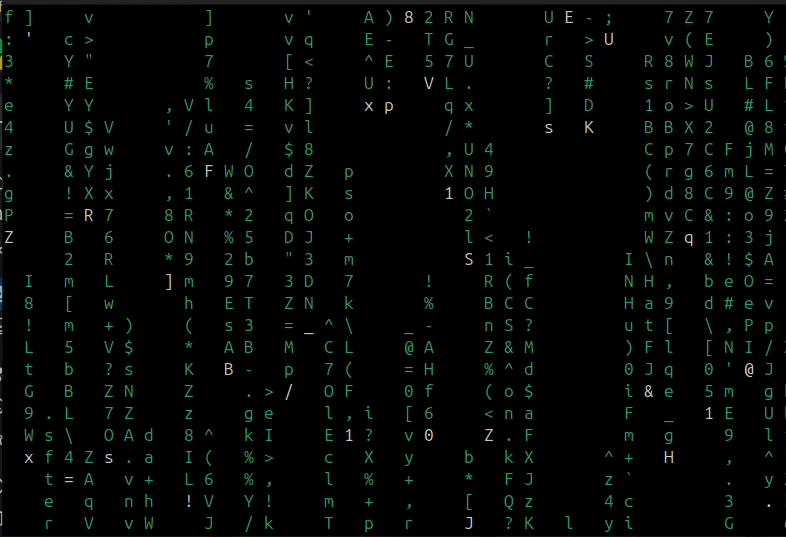
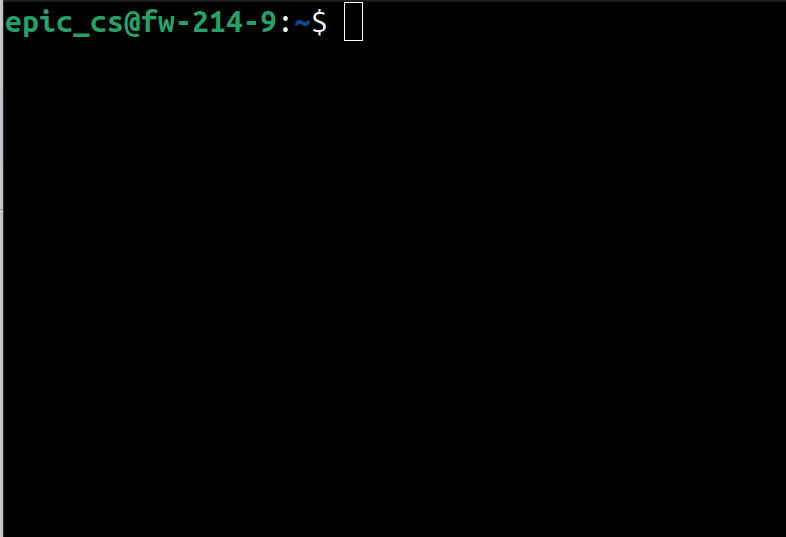
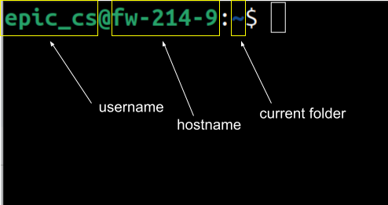
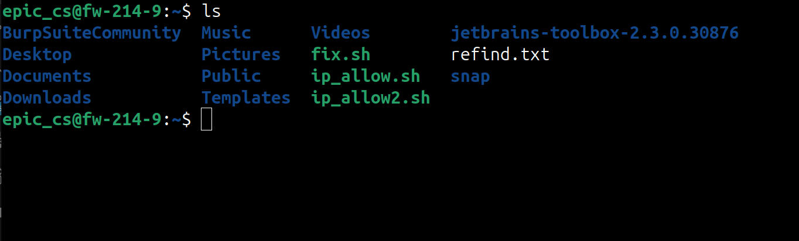
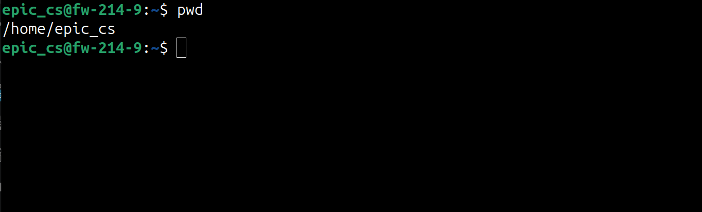
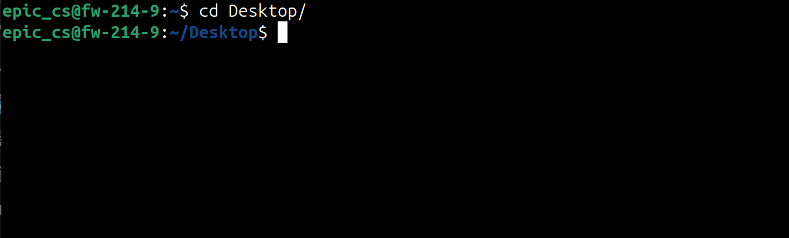

# Terminal Commands Notes

<tabs>
<tab title="Grade Level">

## Welcome to the Terminal

The **terminal** is a text-based interface that is used to communicate with your computer. You enter commands in the terminal and the associated program will run on your computer.

1. Once you are logged in, use `CTRL-ALT-T` to open the terminal. If you are on your home computer or a chromebook you can use [the website](https://epic-terminal.chals.io/). Here is my terminal: 

2. Look at your terminal header. It contains some important information.

- **username** - the name of the user you are currently logged into the computer as
- **hostname** - the name of the computer you are using
- **current folder** - the folder you are currently "in". By default you are in your user's home folder(`~`).

3. Type `ls` in your terminal and hit enter. You should see a *list* of all the files and folders in your current folder.

4. Type `pwd` into your terminal and hit enter. You should see the current **full path** to the folder you are in. This is a list of folders separated by slashes.

Currently, I am in the folder `epic_cs` which is in the folder `home` which is in the largest folder on the filesystem `/`. On computers, **filesystems** are made up of folders inside folders inside folders. `/` is the largest folder on the system and contains all of the data stored on your computer. All of your user's data is always in the folder `/home/<YOUR USERNAME>`; it is also called your **home folder**. Your home folder is also called `~` for short. Your home folder contains your `Documents`, `Desktop`, and `Downloads` folders. 

5. Type `cd Desktop` into your terminal and hit enter. *Make sure you capitalize Desktop!*. 

You have now "changed directories" into your `Desktop` folder. You will see your current path has been updated in your terminal header. If you list the files in this folder with `ls` you will see everything on your Desktop.

## Terminal Commands Cheat Sheet

| Command | Description | 
| --- | --- | 
|`cd <directory>`| Changes the directory to the directory listed|
|`cd ..`| Moves up one folder in the directory hierarchy|
|`~`| Represents the home directory |
|`.`|Represents your current directory|
|`ls`| Lists the files in the current directory |
|`ls -a`|Lists the files in the current directory, including hidden files(files whose name starts with `.`)|
|`touch <file>`| Creates a new file|
|`cat <file>`| Prints the contents of the file|
|`rm <file>`| Removes the file|
|`pwd`|Prints full path of the current directory. Stands for print working directory. |
|`find <path> <criteria>`| Lists files in the given path that meet the criteria. For example, `find . -name "file.txt"` looks for an exact file name in the current folder.|
|`file <options> <file>`| It performs internal tests to identify whether a file is text, an image, a compiled binary, or a zip archive.|
|`ssh username@ip_address -p <port>`|Lets you remotely control a computer. It logs into the computer at the IP with the username given on the port given. |
| `scp <file> username@ip_address:/home/username/destination_folder/` |Copies the file to the computer accessible at the IP using the user listed in the directory listed. |
|`nano <file>`| Edits file. Press Ctrl + O to save and Ctrl + X to exit.|
|`mkdir <directory>`|Creates the directory |
|`rmdir <directory>`|Removes the directory|
|`grep "pattern" <file>` |Finds every line in the file that contains the pattern|
|`wget <url>`|Downloads the URL to the computer |
|`mv <current path> <new path>`|Moves a file from one path to another. Can be used to rename files|
|`cp <file> <new path>`|Creates a duplicate of the file at the given path|
|`gh auth login` |Logs into GitHub|
|`git clone <URL>`| Copies or "clones" the remote GitHub repository to your local computer |
|`git add .`|Stages all the changes in your current directory |
|`git commit -m "message"` |Commits your changes with the given message |
|`git push -u origin main` |Pushes to your remote repository and sets the main branch as the default |
|`git push` |Pushes your changes to your remote repository|
|`CTRL-ALT-T`|Keyboard shortcut for opening the terminal|
|`history`| Shows your terminal history |
|`man <command>`|Shows the manual for the command|
|`clear` or `CTRL-L`|Clears the screen|

</tab>
<tab title="Explain It Like I'm 10">

## Words to Know

- **Terminal:** a window where you type commands to your computer instead of clicking on things.
- **Command:** one instruction, like `ls`. Type it, press Enter, and the computer runs it.
- **Folder** (also called a **directory**): a container that holds files and other folders.
- **Path:** directions to a file or folder, written as folder names separated by slashes, like `/home/epic_cs/Desktop`.
- **Home folder** (`~`): your own folder, where your Desktop, Documents, and Downloads live.

## Opening the Terminal

Press `CTRL-ALT-T` on a school computer. At home or on a Chromebook, use [the website](https://epic-terminal.chals.io/).

The text at the start of each line shows three things: your username, the computer's name (the hostname), and the folder you're in.

## Folders Inside Folders

Think of a filing cabinet. The whole cabinet is `/`. Inside it are drawers, inside the drawers are folders, and inside those are more folders and files. Your home folder is one of them, at `/home/<your username>`.

The terminal is always "in" one folder at a time. Commands work in that folder unless you tell them to look somewhere else.

## Moving Around

| Command | What it does |
| --- | --- |
| `pwd` | Shows the folder you're in, as a full path |
| `ls` | Lists everything in the folder you're in |
| `cd Desktop` | Moves into the `Desktop` folder |
| `cd ..` | Moves up one folder |
| `cd ~` | Goes back to your home folder |

Capital letters matter. `Desktop` and `desktop` are two different names.

## Working With Files

| Command | What it does |
| --- | --- |
| `touch notes.txt` | Makes a new, empty file |
| `nano notes.txt` | Opens the file so you can edit it. `Ctrl + O` saves, `Ctrl + X` exits |
| `cat notes.txt` | Shows what's inside the file |
| `cp notes.txt backup.txt` | Makes a copy |
| `mv notes.txt Desktop/` | Moves the file. `mv old.txt new.txt` renames it |
| `rm notes.txt` | Deletes the file |
| `mkdir projects` | Makes a new folder |

`rm` doesn't send files to the Trash. Once a file is deleted, it's gone.

## Other Useful Commands

- `find` searches for files by name, and `grep` searches inside files for words.
- `ssh` lets you control another computer, and `scp` copies files to it.
- `wget` downloads a file from the internet.
- The `git` commands save your code and send it to GitHub.

The full list is on the Grade Level tab.

## Getting Help

- `man ls` shows the manual for `ls`. Press `q` to leave it.
- The up arrow brings back the last command you typed. `history` shows all of them.
- The `Tab` key finishes typing a file or folder name for you.
- `clear` or `CTRL-L` clears the screen.

</tab>
<tab title="Just the Highlights">

## Key Ideas

- The filesystem is a tree of folders that starts at `/`. Your home folder is `/home/<username>`, or `~` for short.
- The terminal is always in a **current folder**. `pwd` shows it, and paths that don't start with `/` or `~` start from there.
- `.` is the current folder, `..` is the folder above it, and `~` is your home folder.
- Names are case sensitive. Files whose names start with `.` are hidden. Use `ls -a` to see them.
- `rm` deletes for good. `rmdir` only removes empty folders.

## Commands by Task

| Task | Commands |
| --- | --- |
| Find your way around | `pwd`, `ls`, `ls -a`, `cd <directory>`, `cd ..` |
| Make, view, and edit files | `touch`, `cat`, `nano`, `mkdir` |
| Move, copy, and delete | `mv`, `cp`, `rm`, `rmdir` |
| Search | `find <path> -name "<name>"`, `grep "pattern" <file>`, `file <file>` |
| Other computers and the web | `ssh user@ip -p <port>`, `scp <file> user@ip:<path>`, `wget <url>` |
| Git | `gh auth login`, `git clone <URL>`, `git add .`, `git commit -m "message"`, `git push` |
| Help | `man <command>`, `history`, `clear` |

## Shortcuts

| Keys | What they do |
| --- | --- |
| `CTRL-ALT-T` | Open the terminal |
| `Tab` | Finish a file or folder name |
| Up arrow | Bring back the last command |
| `CTRL-L` | Clear the screen |
| `Ctrl + O`, `Ctrl + X` | Save and exit in `nano` |

</tab>
</tabs>
