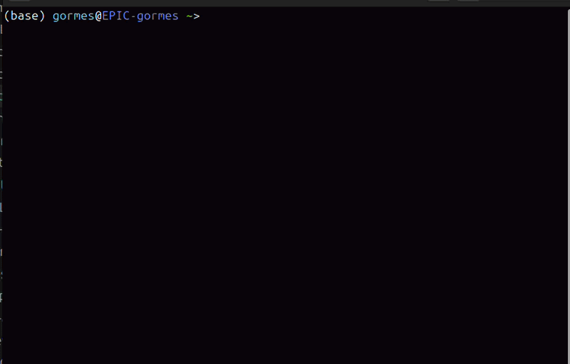
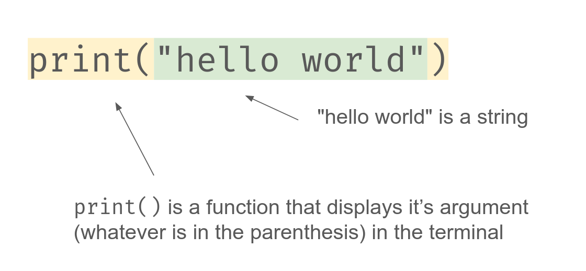
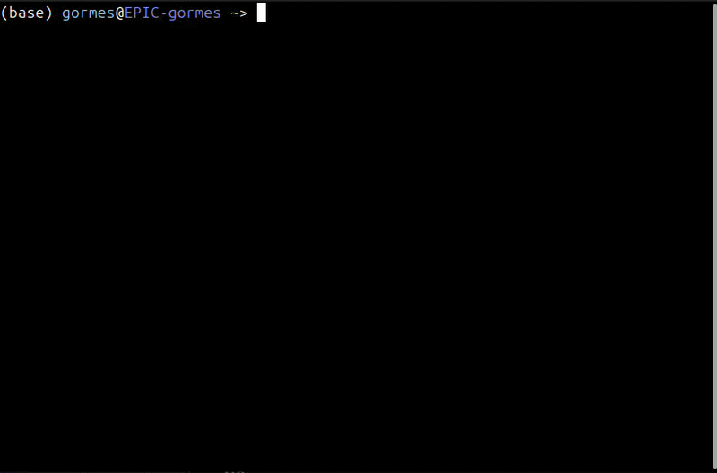
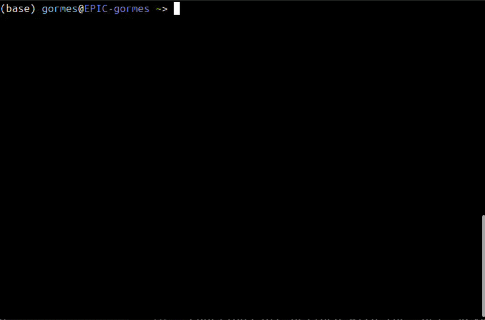
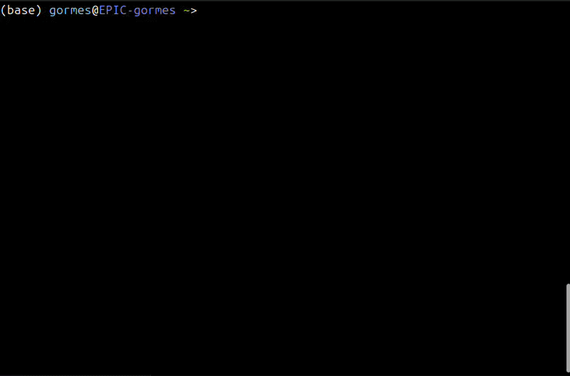
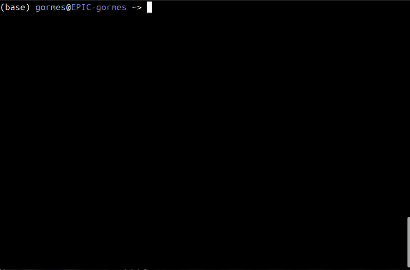
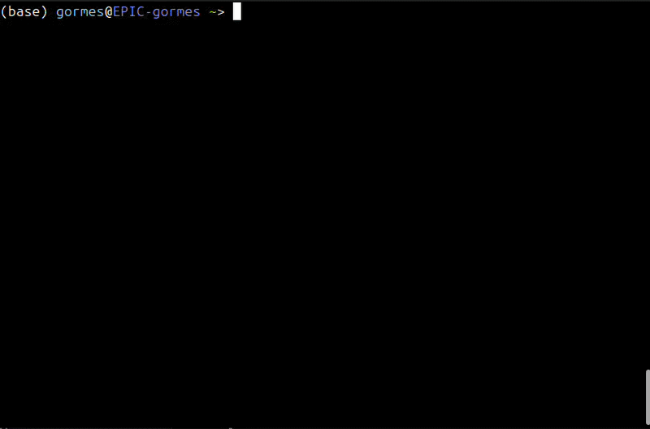

# Variables and Functions Notes

<tabs>
<tab title="Grade Level">

## Vocabulary
| Vocabulary| Description |
| ----------- | ----------- |
| file extension | a short suffix at the end of a file name that tells your computer what kind of data is inside and which program should open it (ex. `.txt` or `.py`)|
| Python interpreter | the program that reads Python files and executes them line-by-line |
| function | a named block of code that runs when the function is called |
| calling a function | using a function. To call a function, you type its name followed by parentheses. Any arguments go inside the parentheses, separated by commas |
| argument | a value passed to a function |
| return value | the value a function sends back to the code that called it |
| string | a data type that holds text and is always surrounded by quotation marks |
| variable | a named spot in memory that holds a value |
| variable type or data type | classifications of data that your interpreter uses (ex. string, integer, or float) |
| integer (int) | a data type that holds whole numbers |
| float | a data type that holds numbers with decimals |
| type conversion | changing a value from one data type to another, like turning the string `"15"` into the integer `15` |
| scope | the part of a program where a variable can be used |

## Hello World

1. Create a new file on your computer called `hello.py`. You can use VS Code or just open the terminal and use `touch hello.py`.

2. Inside the file, put `print("hello world")` and save.

3. Then flip back to your terminal and run the program with `python3 hello.py`. You should see `hello world` appear in your terminal!



Congratulations, you just wrote your first Python program!

### What Just Happened?

When you typed `python3 hello.py` in your terminal, you used the **Python interpreter** to execute `hello.py` line-by-line. A Python interpreter is the software program that reads and executes Python code. Computers cannot directly understand human-readable languages like Python, so they require a translator. The interpreter acts as this translator, converting your code into instructions that your computer's hardware can actually execute.

In your program, you only had one line: `print("hello world")`.

Let's break down what this statement means:


`print()` is a function that prints out whatever is in the parentheses (the argument) to the console. A **function** is a named block of code that is executed when the function is called. An **argument** is a value passed to a function, inside the parentheses, that the function uses. *Note: when you are Googling you may come across the term parameter, which is extremely similar to argument. Technically there is a difference, but for the purposes of this class we will use the term argument.*

In our example, `"hello world"` is an example of a string. A **string** is a data type in Python that holds text and is always contained in quotation marks. This helps us distinguish between function names, variables, and regular text!

### Modifying Your Program

Try changing `"hello world"` to a different string, but keep the quotation marks. What happens to the output?

What happens when you type `print("hello world)`? Or `print("hello world`?

Notice that when you make an error, the interpreter tells you exactly what error occurred and which line it was on. This is incredibly useful for fixing your program!

### Comments

Any text after a `#` is a **comment**. The interpreter ignores comments, so you can use them to leave notes that explain your code.

```python
# This program greets the user
print("hello world")  # Comments can also go at the end of a line
```

## Creating Variables

Let's create a new program that uses a variable. Very similar to math class, a **variable** is a named container in memory that holds a value.

Create a new program called `greeting.py` with the following contents:

```python
name = "Steve"
print("Hello name!")
```

`name` is an example of a variable. This variable is called `name` and has a value of `"Steve"`. Note that `"Steve"` is a string, so we would say that `name` has the data type string.

Before you run your program, guess what you think it will output.



Hmm... what happened there? We wanted to print out `Hello Steve!`, but we got `Hello name!` instead. Since `name` is inside the quotes, it is part of the string. Let's try this instead:

```python
name = "Steve"
print("Hello " + name + "!")
```



We did it! Instead of putting `name` inside the quotes, we added it to two other strings. Joining strings together with `+` is called **concatenation**.

Another way to get the same result is to use a **formatted string**, or **f-string**. We put `f` before the quotes and then put the name of our variable in curly braces (`{}`).

```python
name = "Steve"
print(f"Hello {name}!")
```

Let's create a second variable. Change `greeting.py` to contain the following:

```python
name = "Steve"
age = "15"
print("My name is " + name + " and I am " + age + " years old.")
```

Anytime you want to create a variable, you use the variable's name, then a single equal sign (`=`), followed by what you want to be in the variable. The value on the right is **assigned** to the variable on the left. If you assign a new value to a variable that already exists, the old value is replaced.

### Naming Variables

Variable names follow a few rules:
- They can contain letters, numbers, and underscores (`_`), but **can't start with a number**. `score2` works, but `2score` doesn't.
- They can't contain spaces. In Python, we use `snake_case` instead, like `first_name`.
- They can't be a word Python already uses, like `if`, `def`, or `print`.
- They're case-sensitive: `name` and `Name` are two different variables.

Choose names that describe what the variable holds. `total_price` is much easier to understand than `tp` or `x`.

To visualize how variables appear in memory throughout execution, use [Python Tutor's Visualizer](https://pythontutor.com/visualize.html#mode=edit). You can step through programs line-by-line and see how the variables exist in memory.

## Integers and Floats

Create a new program `sum.py` with the following contents. Guess what you think will happen before running.
```python
a = "2"
b = "2"
c = a + b
print(c)
```



Hmmm, something weird happened: it printed `22`. Our interpreter treated the number 2 as a string. This makes sense because 2 is inside quotation marks, so `+` joined the two strings together instead of adding them. Let's try this instead:
```python
a = 2
b = 2
c = a + b
print(c)
```



Nice! We added the two numbers. Without the quotes, `a` and `b` are examples of **integers**. Integer, or int, is a data type that holds whole numbers, like 2.

Let's make a new file `cost.py`.

```python
price = 19.99
tax = 0.07
total = price + price * tax

print("$" + total)
```

`price`, `tax`, and `total` are all examples of **floats**. Float is a data type that holds numbers with decimal parts. They function very similarly to integers.

But when you run this program, you get an error: `TypeError: can only concatenate str (not "float") to str`. Python won't use `+` between a string and a number, because it doesn't know whether you want to add them or join them. One way to fix this is with an f-string:

```python
price = 19.99
tax = 0.07
total = price + price * tax

print(f"${total:.2f}")  # $21.39
```

The `:.2f` inside the curly braces rounds the number to 2 decimal places.

### Checking a Variable's Type

The `type()` function tells you a value's data type. This is helpful when your program isn't behaving the way you expect.

```python
print(type("15"))   # <class 'str'>
print(type(15))     # <class 'int'>
print(type(15.0))   # <class 'float'>
```

### Converting Between Types

You can convert a value from one type to another with these functions:

| Function | Converts to | Example | Result |
| ----------- | ----------- | ----------- | ----------- |
| `int()` | integer | `int("15")` | `15` |
| `float()` | float | `float("2.5")` | `2.5` |
| `str()` | string | `str(15)` | `"15"` |

The value has to make sense as the new type. `int("15")` works, but `int("fifteen")` causes a `ValueError`.

## Mathematical Operators

In Python, we can use all of the traditional operators on integers and floats. For example:

```python
a = 3
b = 5

print(a + b) # 8
print(a - b) # -2
print(a * b) # 15
print(a / b) # 0.6
```

Notice that `/` always gives back a float, even when the answer is a whole number: `6 / 3` is `2.0`.

There are also three more operators that are less common.

### Integer Division

The `//` operator divides and then drops anything after the decimal point, so the result is always a whole number.

```python
a = 7
b = 2

print(a // b) # 3
```

### Modulus

The `%` operator represents **modulus**, or the remainder after division. For example:

```python
a = 5
b = 2

print(a % b) # 1
```

This prints 1 since 5/2 is 2 with a remainder of 1. A common use of modulus is checking whether a number is even: if `n % 2` is `0`, then `n` is even.

### Power

The `**` operator represents exponents.

```python
a = 5
b = 2

print(a ** b) # 25
```

This prints 25 since $5^2$ is 25.

### Order of Operations

Python follows the same order of operations as math class: parentheses first, then exponents, then multiplication and division (including `//` and `%`), and finally addition and subtraction.

```python
print(2 + 3 * 4)    # 14
print((2 + 3) * 4)  # 20
```

## User Input

One way we can make our programs more interactive is to use the `input()` function. Create a new file `login.py` with the following contents:
```python
username = input("Enter your username: ")
print(username + ", you're in!")
```

As you run the program, notice the prompt in the parentheses is printed to the terminal. Then whatever the user types in is saved to the variable `username`.



Let's do another example in a new file `years.py`:

```python
age = input("Enter your age: ")
age = int(age)
years_left = 100 - age

print(f"You will turn 100 years old in {years_left} years.")
```

The first line takes in an age as user input. **`input()` always gives back a string**, even if the user types a number. The second line converts the age to an integer, so we can do math with it. Then we can calculate how many years the user has left before they turn 100. Finally, we print out the calculated value to the user.

## Using String Functions

As we are programming, we can use different built-in string functions to modify our strings. Let's try one here:
```python
text = input("What do you want to say? ")
text = text.upper()
print(text)
```
Notice that on our second line, we need to set `text` to the value of `text.upper()`. Writing `text.upper()` on its own creates an uppercase copy of the string, then throws it away. **String functions never change the original string.** To keep the result, you have to save it in a variable.

Reference [this full list](https://www.w3schools.com/python/python_ref_string.asp) of all possible string functions as you work on the lab.

## Creating Functions
Functions are defined with the `def` keyword, followed by a name, parentheses (with optional arguments), and a colon. The function body is indented.
```python
def say_hello():
    print("Hello!")

say_hello()  # calling the function
```
- `def` starts the definition.
- The function name should be descriptive and follow `snake_case` convention.
- Parentheses `()` hold arguments (inputs), even if empty.
- The body is indented and runs only when the function is **called**.
- A function is only defined once, but can be called many times.
- A function must be defined **before** the line that calls it.

Here is another example function:

```python
def add(a, b):
    total = a + b
    print(total)

add(2, 3)    # 5
add(10, 20)  # 30
```

## Variable Scope

Scope determines where in your code a variable can be accessed.
- **Local scope**: Variables defined inside a function only exist within that function.
- **Global scope**: Variables defined outside any function can be accessed anywhere in the file (read-only inside functions, unless you use `global`).

```python
x = 10  # global

def show():
    y = 5  # local
    print(x, y)  # works: can read global x

show()
print(y)  # ERROR: y doesn't exist outside the function
```

To modify a global variable inside a function, use the `global` keyword:
```python
count = 0

def increment():
    global count
    count += 1
```

Using `global` can make programs hard to follow, since any function might change the variable. Most of the time, it's better to pass values in as arguments and send results back with `return`.

## Arguments
Arguments let you pass data into a function.

```python
def greet(name, greeting):
    print(f"{greeting}, {name}!")

greet("Alice")              # ERROR: Incorrect number of arguments
greet("Bob", "Hi")          # Hi, Bob!
```

- **Positional arguments**: matched by order. The first value goes to the first argument, and so on.
- **Keyword arguments**: matched by name, so the order doesn't matter. `greet(greeting="Hey", name="Cam")` prints `Hey, Cam!`.

## Return Statements
`return` sends a value back to the caller and ends the function.
```python
def square(n):
    return n * n

result = square(4)  # result = 16
```
- A function without `return` returns `None`.
- Code after `return` inside a function never runs.

### Return vs. Print

`print()` shows a value on the screen, but the rest of your program can't use it. `return` hands the value back, so you can save it in a variable, do more math with it, or pass it to another function.

```python
def add_print(a, b):
    print(a + b)

def add_return(a, b):
    return a + b

x = add_print(2, 3)   # Prints 5, but x is None
y = add_return(2, 3)  # Prints nothing, but y is 5
print(y * 10)         # 50
```

If you `print()` a function that doesn't return anything, you'll see `None` in your output. That's a sign the function is printing when it should be returning.

## Common Errors

| Error | What it usually means |
| ----------- | ----------- |
| `SyntaxError` | Something is typed wrong, like a missing quotation mark, parenthesis, or colon. |
| `NameError` | You used a variable or function that doesn't exist yet. Check your spelling, and make sure it's created before you use it. |
| `TypeError` | You used two types that don't work together, like `"$" + 5`, or called a function with the wrong number of arguments. |
| `ValueError` | The type is right, but the value isn't, like `int("hello")`. |
| `IndentationError` | The spaces at the start of a line don't line up, like a function body that isn't indented. |

## Additional Resources

- [Watch this video for CS50 Week 0](https://cs50.harvard.edu/python/weeks/0/)
- [Python Visualizer](https://pythontutor.com/visualize.html#mode=edit)

</tab>
<tab title="Explain It Like I'm 10">

## Words to Know

- **Program:** a list of instructions for the computer to follow, in order.
- **Interpreter:** the translator that turns your Python code into something the computer understands.
- **Variable:** a labeled box that holds a value.
- **Data type:** what kind of value is in the box, like text or a number.
- **String:** text, always inside quotation marks.
- **Integer:** a whole number, like `7`.
- **Float:** a number with a decimal point, like `7.5`.
- **Function:** a named set of instructions you can use over and over, like a recipe.
- **Argument:** a value you hand to a function to use, like an ingredient.
- **Return value:** the answer a function hands back when it's done.

## Your First Program

A program is a list of instructions. Here's one with just a single instruction:

```python
print("hello world")
```

Save it in a file called `hello.py`, then run it in the terminal with `python3 hello.py`. The words `hello world` show up on the screen.

Computers don't actually understand Python. When you run your program, the **Python interpreter** reads it one line at a time and translates each line into instructions the computer can follow. It's like having a translator read a letter out loud in another language.

`print()` is a **function**: a built-in instruction that shows whatever you put inside the parentheses. The text in quotes, `"hello world"`, is a **string**. The quotation marks tell Python, "this is just text, not an instruction."

## Variables: Labeled Boxes

A **variable** is like a box with a label on it. You put a value in the box, and later you can use the label to get it back out.

```python
name = "Steve"
```

This makes a box labeled `name` and puts `"Steve"` inside. The `=` sign means "put the value on the right into the box on the left." It doesn't mean "equals" like in math class.

Now you can use the box:

```python
name = "Steve"
print(f"Hello {name}!")   # Hello Steve!
```

The `f` before the quotes, plus the curly braces, tells Python: "Don't print the word `name`. Look inside the box called `name`, and print what's in there."

If you put something new in a box, the old value gets replaced:

```python
name = "Steve"
name = "Maya"
print(name)   # Maya
```

## Kinds of Values

Not everything in a box is the same kind of thing. The kind of value is called its **data type**:

| Type | What it holds | Example |
| ----------- | ----------- | ----------- |
| string | text, in quotes | `"Steve"`, `"15"` |
| integer | whole numbers | `15`, `-3` |
| float | numbers with a decimal point | `19.99`, `0.5` |

The type matters a lot. Look at what happens here:

```python
print("2" + "2")   # 22
print(2 + 2)       # 4
```

With quotes, `"2"` is **text**, not a number. Using `+` on two strings glues them together, like putting two word magnets side by side. Without quotes, `2` is a number, and `+` actually adds.

And if you try to mix them, like `"2" + 2`, Python gets confused and gives you an error, because it can't tell whether you want to glue or add.

## Changing Types

Sometimes you need to change a value from one type to another. There's a function for each type:

```python
int("15")     # The string "15" becomes the number 15
str(15)       # The number 15 becomes the string "15"
float("2.5")  # The string "2.5" becomes the number 2.5
```

This is really important with `input()`, which asks the user to type something. **Whatever the user types always comes in as a string**, even if it's a number. So before you can do math with it, you have to change it into a number:

```python
age = input("Enter your age: ")   # Comes in as text, like "12"
age = int(age)                    # Now it's the number 12
print(f"In 5 years you'll be {age + 5}.")
```

## Math in Python

Python can do math, but a few of the symbols look different from math class:

| Symbol | What it does | Example | Answer |
| ----------- | ----------- | ----------- | ----------- |
| `+` | add | `7 + 2` | `9` |
| `-` | subtract | `7 - 2` | `5` |
| `*` | multiply | `7 * 2` | `14` |
| `/` | divide | `7 / 2` | `3.5` |
| `//` | divide, and drop the decimal | `7 // 2` | `3` |
| `%` | the remainder after dividing | `7 % 2` | `1` |
| `**` | to the power of | `7 ** 2` | `49` |

The `%` symbol is useful for more than you'd think. If a number divided by 2 has a remainder of 0, the number is even!

## Functions: Recipes

A **function** is like a recipe. You write the recipe once, then you can make it whenever you want, as many times as you want.

```python
def say_hello():
    print("Hello!")

say_hello()
say_hello()
```

- `def` means "here's a new recipe." Then comes the recipe's name, parentheses, and a colon.
- The indented lines underneath are the steps in the recipe.
- Writing the recipe doesn't cook anything. The steps only run when you **call** the function by writing its name with parentheses: `say_hello()`.

## Arguments: Ingredients

Most recipes need ingredients. Functions can take ingredients too, called **arguments**:

```python
def greet(name, greeting):
    print(f"{greeting}, {name}!")

greet("Bob", "Hi")      # Hi, Bob!
greet("Maya", "Hey")    # Hey, Maya!
```

Same recipe, different ingredients, different results. The ingredients get matched up in order: the first value goes to `name`, and the second goes to `greeting`. If you leave one out, Python gives you an error, because the recipe is missing something it needs.

## Return: Handing Back the Answer

Imagine a vending machine. You put in money, and it **hands you back** a snack. You can then do whatever you want with the snack.

That's what `return` does. It hands a value back to whoever called the function:

```python
def square(n):
    return n * n

result = square(4)   # result is now 16
print(result + 1)    # 17
```

Compare that to `print()`. Printing is like the vending machine just showing a picture of the snack on its screen. You can see it, but you can't take it with you or use it for anything else.

If you need to use the answer later, `return` it. If you just want to show it, `print` it.

## Scope: What Happens in the Function Stays in the Function

Variables made **inside** a function only exist inside that function. Think of it like a scratch paper you use while solving one problem, then throw away when you're done.

```python
def show():
    y = 5
    print(y)   # Works: we're inside the function

show()
print(y)       # Error! y was thrown away when the function finished
```

Variables made **outside** any function can be read anywhere in the file. If you need a value from inside a function, the best way to get it out is with `return`.

## When Things Go Wrong

Errors are normal, even for professional programmers. When something goes wrong, Python tells you **what** went wrong and **which line** it's on. Read the last line of the error message first. It usually tells you the most.

- **`SyntaxError`:** something's typed wrong, like a missing quote, parenthesis, or colon.
- **`NameError`:** Python doesn't recognize a name. Check your spelling!
- **`TypeError`:** you mixed types that don't work together, like `"$" + 5`.
- **`IndentationError`:** the spaces at the start of a line don't line up.

</tab>
<tab title="Just the Highlights">

## Running Python

- Save code in a `.py` file, and run it with `python3 file.py`.
- The **interpreter** runs the file top to bottom, one line at a time.
- `#` starts a comment, which the interpreter ignores.
- Error messages tell you the error type and the line number. Read the last line first.

## Variables and Types

- `name = value` assigns the value on the right to the variable on the left. Assigning again replaces it.
- Names use `snake_case`, can't start with a number, and are case-sensitive.

| Type | Example | Notes |
| ----------- | ----------- | ----------- |
| `str` | `"15"` | text, in quotes. `+` joins strings |
| `int` | `15` | whole numbers |
| `float` | `15.0` | numbers with decimals. `/` always returns a float |

- `type(x)` tells you a value's type.
- `int()`, `float()`, and `str()` convert between types. A value that doesn't fit, like `int("abc")`, causes a `ValueError`.
- `input()` **always returns a string**. Convert it before doing math.

## Strings

- **f-strings** put variables into text: `f"Hello {name}!"`. Use `{total:.2f}` for 2 decimal places.
- `"$" + 5` is a `TypeError`. Use an f-string or `str()`.
- String methods return a **new** string and never change the original: `text = text.upper()`.

## Operators

| Operator | Meaning | `7 ? 2` |
| ----------- | ----------- | ----------- |
| `+` `-` `*` | add, subtract, multiply | `9`, `5`, `14` |
| `/` | divide | `3.5` |
| `//` | integer division | `3` |
| `%` | remainder (modulus) | `1` |
| `**` | exponent | `49` |

Order of operations: parentheses, exponents, then `*` `/` `//` `%`, then `+` `-`.

## Functions

```python
def function_name(arg1, arg2):    # Define once
    result = arg1 + arg2          # Indented body
    return result                 # Send a value back

answer = function_name(2, 3)      # Call as many times as you like
```

- A function must be defined before the line that calls it.
- **Positional** arguments match by order. **Keyword** arguments match by name: `greet(greeting="Hi", name="Bob")`.
- The wrong number of arguments is a `TypeError`.

## Return vs. Print

- `return` hands a value back to the caller, and ends the function immediately.
- `print` only shows a value on screen. The caller gets nothing back.
- A function with no `return` returns `None`. Seeing `None` in your output usually means a function printed when it should have returned.

## Scope

- **Local** variables, created inside a function, disappear when the function ends.
- **Global** variables, created outside every function, can be read anywhere.
- Changing a global inside a function requires `global name`. Usually, it's better to pass values in with arguments and send results back with `return`.

## Common Errors

| Error | Usual cause |
| ----------- | ----------- |
| `SyntaxError` | missing quote, parenthesis, or colon |
| `NameError` | misspelled name, or used before it was created |
| `TypeError` | mixing types (`"$" + 5`), or the wrong number of arguments |
| `ValueError` | right type, impossible value (`int("hello")`) |
| `IndentationError` | inconsistent spaces at the start of a line |

</tab>
</tabs>
