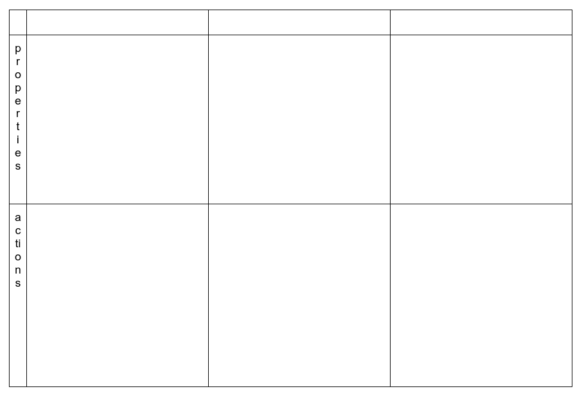

**Objective:** Use the steps below to design a system of classes to model a real world situation.

**Description:**
> An airline wants to keep track of its flights and the people traveling on them. Each flight has a flight number, such as UA482, and a destination city, and it carries a group of passengers. A flight has a maximum number of seats, so the airline needs to know when a flight is full and can’t take any more travelers. Every passenger is known by name. Before boarding, a passenger checks in for their flight and is assigned a seat. Checking in gives the passenger a boarding pass that shows their name, the flight number and their seat, and the passenger can pull up that pass whenever they need it. At the gate, the boarding pass can be printed so the airline staff can see who is getting on the plane and where they will sit.

1. Using the description above identify the three nouns that will make up our classes. *Think about which nouns have properties(instance variables) and actions(instance methods)*

2. For each of the classes, list their properties and actions in the chart below:

3. Label each property with a variable type (string, int, float, list, dictionary, etc.)

4. Label each action with what information is needed to complete the action(arguments) and what information is shared after each action(return type)

5. Write the **Flight** class.