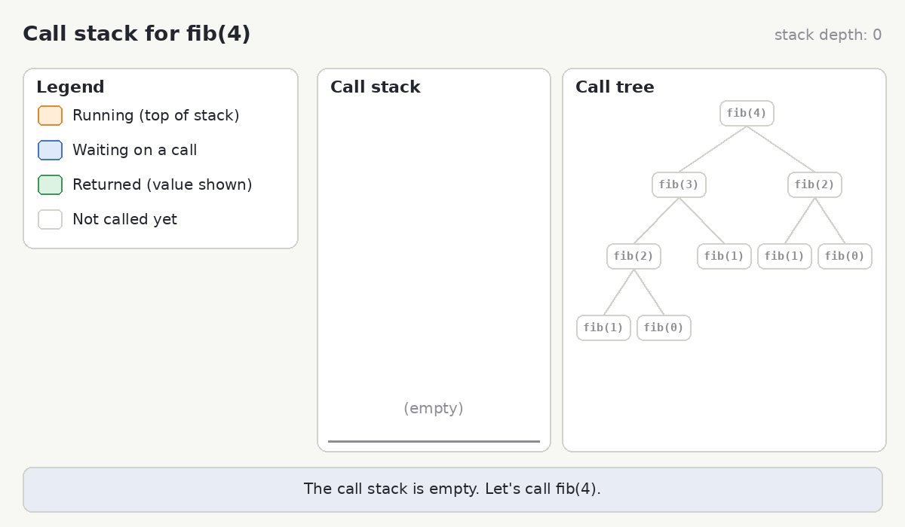
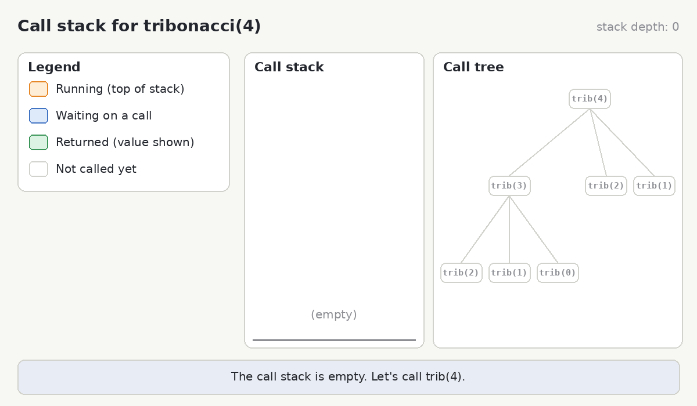

The **Fibonacci Sequence** is a sequence in which each element is the sum of the two elements that precede it. The first two number are `0` and `1`. 

The beginning of the sequence is: 0, 1, 1, 2, 3, 5, 8, 13, 21, 34, 55, 89, 144...

1. Write a recursive method `fibonacci(n)` to solve for the `n`th value of the Fibonacci Sequence.
    - Start by writing out some **test cases**. For example, `fibonacci(3) = 2`.
    - Then identify your **base cases** by answering the question "when should your recursion stop?". You can write out a stack diagram or call tree to help you.
    - Now write your recursive method. Make sure to include both your **recursive cases** and your **base cases**. Remember the only way to share information between stack frames is to return it.

If you need an extra hint, click here to see the stack trace of `fibonacci(4)`

2. The **tribonacci sequence** is a generalization of the Fibonacci sequence where each term is the sum of the three preceding numbers. Write a recursive method `tribonacci(n)` by following the same steps as above.

If you need an extra hint, click here to see the stack trace of `tribonacci(4)`

