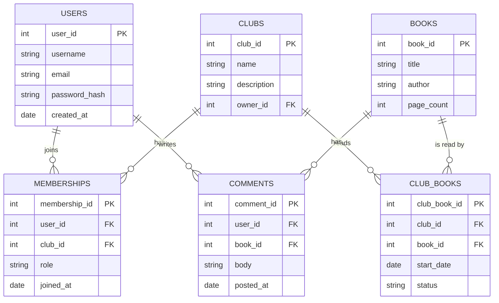

# Data Design Diagram

## Objective
- Create two diagrams to explain the flow of data throughout your program

## Your Task

Collectively, your team must create:
1. A UX diagram showing the multiple screens and how they interact.
    - You are welcome to use Google Drawings or [Excalidraw](https://excalidraw.com/) like before. For a more professional look you can try a software like [Figma](https://www.figma.com/) (or its open source equivalent [Figcraft](https://github.com/storytold/figcraft)). 
2. A UML database diagram that lists the tables in the database and their properties.
    - You may create this yourself or use Mermaid to create a diagram after your have written your schema.

## Examples

Both examples below are for a made-up **Book Club** app, where members join clubs, pick books to read, and post comments about them. Your diagrams will look different, but they should show the same kinds of things.

### Example 1: UX Diagram

Each box is a **screen**, drawn as a mockup of what the user sees. Each arrow shows how a user gets from one screen to another, labeled with the action that takes them there. These screens were mocked up in a design tool, and then connected with arrows.

A good UX diagram:
- Includes **every** screen in your program, including log in, sign up, and error screens.
- Labels each arrow with the button, link, or action that moves the user.
- Shows the main data each screen displays, like a club's current book and members.

### Example 2: UML Database Diagram

Each box is a **table**, listing its columns with their data types. **PK** marks a primary key and **FK** marks a foreign key. The lines show how tables are related. For example, one club has many members, and one book has many comments.

A good database diagram:
- Lists **every** table, with each column's name and data type.
- Marks each table's primary key, and every foreign key.
- Connects related tables, showing whether it's one-to-one or one-to-many. The `||--o{` lines above mean "one to zero or more."
- Uses a **joining table** (like `MEMBERSHIPS`) for many-to-many relationships. One user can join many clubs, and one club has many users.
